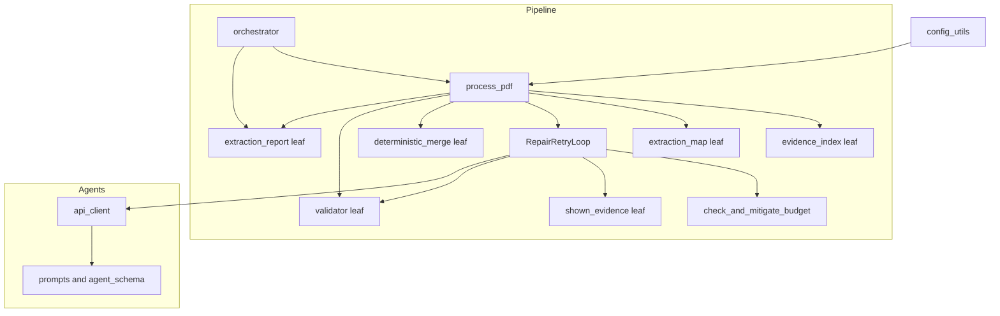
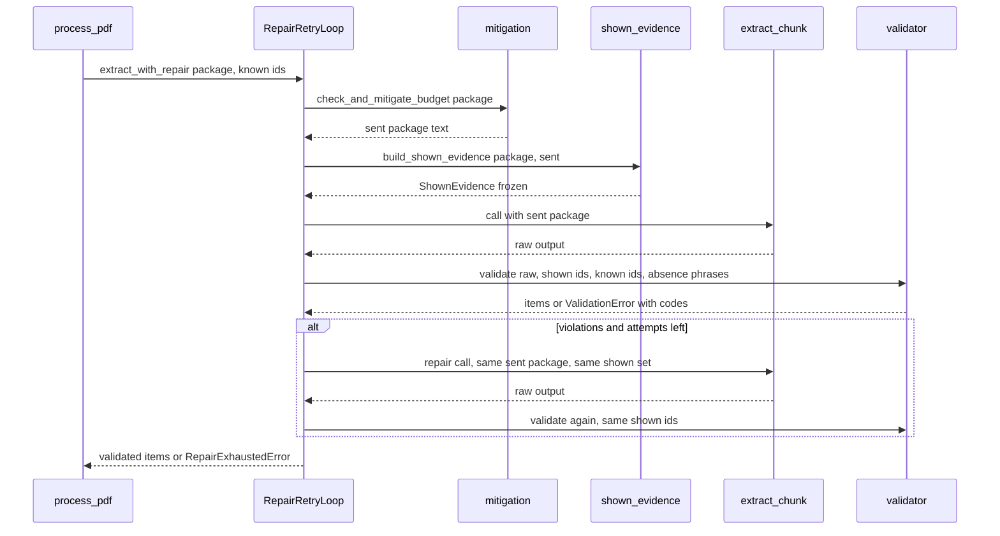
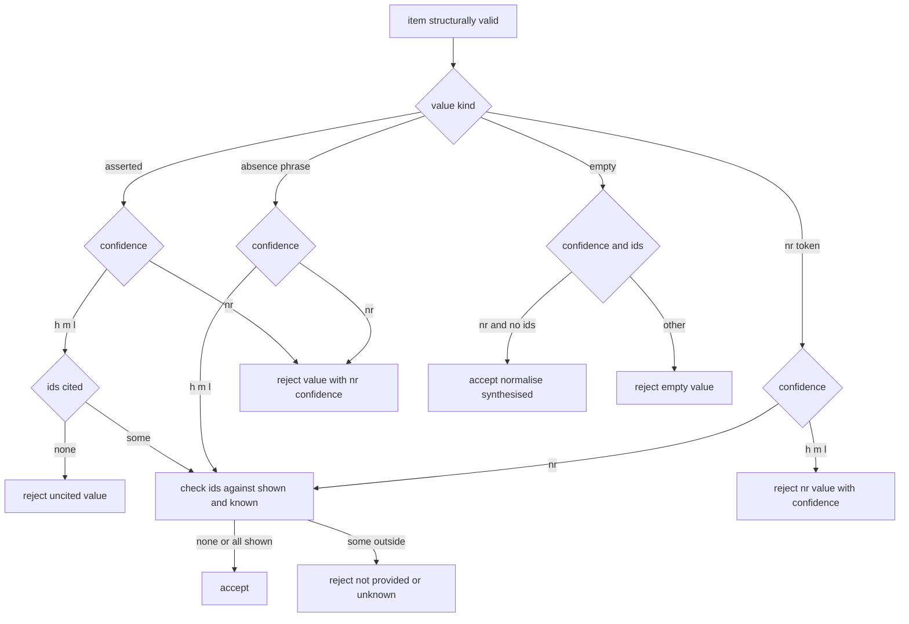

# Design Document

## Overview

**Purpose**: This feature makes the contract between the pipeline and the extraction model explicit, enforced and auditable: every cited evidence id is checked against what that call's prompt actually contained; "not reported" has one defined meaning, the category-valued absences of the extraction map have another, and every `v`/`c`/`loc` combination has a verdict; the pipeline's own placeholders are marked as such; and the artefacts that describe the contract (prompt, agent schema file, prefill labels, configuration, READMEs) agree with the code.

**Users**: Reviewers and auditors reading `outputs/<paper>.extracted.json` and `flagged_fields.csv`; maintainers of downstream specs (`provenance-schema-v2`, `multiagent-extraction`, `evidence-routing`, `evaluation-harness`, `agreement-statistics`, `reviewer-ui`) that consume the shown set and the absence vocabularies; operators who run the pipeline.

**Impact**: An amendment to the existing pipeline in the style of `risk-remediation`. It changes extraction acceptance (a stricter validator with a per-call validation set and one enumerated exemption), one prompt-content change (system instruction, one prefix sentence, repair-prompt format and violation templates), two persisted optional output keys (`nr_origin`, `absence_like`), one additive evidence-cache record, fallback prefill labels, a configuration lower bound, three appended report columns and several documents. It adds one stdlib-only module and no package, no configuration key and no import edge between packages. The work is ordered so that every step leaves the suite green (Testing Strategy, Requirement 10.10).

Every statement about existing code below was checked against HEAD `c21c929`; measured facts and unverified assumptions are in `research.md` (M1-M14, A1-A6); decisions with rejected alternatives are D1-D35 there.

### Goals

- A call's shown set is exact, computed once, immutable, validated against, reused by repairs, and readable by the per-document code.
- The verdict table of Requirement 2.10 is the validator's behaviour, total over its inputs, with aggregated violations per repair message.
- Every `nr` field carries a closed-vocabulary origin; every absence-phrase value carries a marker; the report classifies absences with names that do not overclaim (`ids_cited`, `no_ids`).
- The prompt states what the validator enforces; the only model-facing text changes are declared and pinned; the shared prefix stays cache-stable whenever no mitigation applies.
- Provenance, graph and schema work stays out; nothing here depends on a provenance recorder, up to one named, temporary exception.

### Non-Goals

- Tolerating one bad id among 62 fields; tolerating uncited yes/no/none or judged values (a recorded limitation, Requirement 9.9; no tolerance setting).
- Removing the exhaustion-retain path of `provenance-core` 5.4 (owned by `provenance-schema-v2`).
- Letting fallback-prefilled fields fall through to model extraction; changing the 62-field map; routing, verification or repair agents; the OpenAI client or its strict JSON schema.
- Interpreting natural-language absence phrases other than a field's own listed absence categories.
- Measuring real model behaviour (none exists; `research.md` A1, A2).

## Boundary Commitments

### This Spec Owns

- **Shown-set definition and computation**: `ShownEvidence`, `build_shown_evidence`, and its exposure by `RepairRetryLoop.shown_evidence` (read-only, per call, keyed `(call_kind, chunk)`).
- **The model-output contract**: the not-reported token, the confidence coupling, the citation rule and its absence-phrase exemption, the empty-value rule, the closed violation codes, their message templates and aggregated reporting (`validator.py`).
- **The absence-phrase rule**: `derive_absence_phrases` over the extraction map, and the pinned table of its result for the shipped map.
- **The persisted vocabularies**: `nr_origin` (`model`, `pipeline_empty_value`, `pipeline_prefill`, `human`), the optional `absence_like` marker, the report's absence classes (`""`, `ids_cited`, `no_ids`, `pipeline`, `human`, `absence_like`), and who sets each.
- **The sanitisation invariant** for the not-reported token and the markers (`_save_pdf_output`).
- **The prefill labelling policy** and its persisted author-provenance record in the evidence cache entry.
- **Item-granular token-budget mitigation of evidence packages**.
- **Model-facing contract text** and its pins: system instruction (`configs/agent_schema.json`), one prefix sentence, repair-prompt format reference, violation message templates (all pinned as literal strings or digests; prefix goldens).
- **Contract artefacts**: `AgentSchemaValidator`'s accepted keys and `get_version()`, the `num_chunks >= 2` rule, the manifest `extraction_contract` stamp, the `flagged_fields.csv` appended columns and the orchestrator's `below_coverage` result key, the corrected READMEs and the contract section of the pipeline README.
- **Interfaces stabilised for `provenance-schema-v2`** (listed in the review report and in its brief): `ShownEvidence`, `RepairRetryLoop.shown_evidence`, `nr_origin` and its vocabulary, `absence_like`, the class names `ids_cited`/`no_ids`/`absence_like`/`pipeline`/`human`, `EXTRACTION_CONTRACT_VERSION`, `ValidationError.codes`.

### Out of Boundary

- Anything under `src/provenance/`, `claim_provenance.py`, `document_provenance.py`, `run_provenance.py`, the provenance artifact, completeness and findings semantics. `claim_provenance.header_citations` is read, not edited; an equivalence test pins the prefill rule to it.
- The exhaustion-retain path (`provenance-core` 5.4) apart from judging its references against the shown set (Requirement 6.4).
- Evidence selection and serialisation (`select_paper_evidence`, `serialise_evidence_package`): unchanged byte for byte; the evidence-cache key and item format unchanged.
- `src/agents/openai/api_client.py` (strict JSON schema, retries, telemetry); its dead `valid_location_ids` parameter stays.
- `src/quality_control/`, `src/pdf_extractor/`, `src/text_processing/` (the normalisers are not edited; the writer constrains their use), `src/artifact_generation/` (the wide CSV exporter keeps exporting values only).
- The extraction map and the 13-domain chunk assignment.
- Cross-invocation resume (`cost-and-run-reporting`), the privacy gateway (`privacy-core`), the review layer that may write the `human` origin (`reviewer-ui`).

### Allowed Dependencies

- `shown_evidence.py`: Python standard library only.
- `validator.py`, `deterministic_merge.py`, `evidence_index.py`, `extraction_report.py`, `extraction_map.py` stay **leaf modules**: they import only top-level packages (`utils`, `provenance` under `TYPE_CHECKING` or existing adapters, `pdf_extractor`) and never a sibling in `pipeline/`. Test modules load them by file path (`research.md` M3); an AST guard pins this.
- `pdf_processor.py` may import the leaves relatively (as it does today) and `agents.openai.*` only lazily inside function bodies. `orchestrator.py` gains a manifest read only.
- `agents/` gains no import of `pipeline`, `quality_control`, `pdf_extractor` or `provenance`; `pipeline` gains no module-level import of `provenance` beyond what exists. No row of `tests/test_dependency_directions.py` changes.
- Heavy optional dependencies stay lazy; no new third-party dependency.

### Revalidation Triggers

- **Verdict table, token, violation codes, message templates, absence-phrase rule** (`validator.py`, `extraction_map.py`): `multiagent-extraction` (R2 uses the same rules; its extraction QC should reuse the codes and the absence-phrase exemption), `evaluation-harness` 3.3 (asserted-only denominators: exclude `absence_like` and `nr` from "asserted findings" or count them separately), `agreement-statistics` 1.3, tests below.
- **`nr_origin` vocabulary, `absence_like`, absence class names, `final_output_schema.json`**: `provenance-schema-v2` (claim origin and absence mapping; must follow `ids_cited`/`no_ids`; must treat `absence_like` claims as not `unsupported`), `reviewer-ui` 4.4 (the `human` origin), `cost-and-run-reporting` (its planned envelope key on the same schema, design line 817), flagged-report consumers.
- **`ShownEvidence` shape, `RepairRetryLoop.shown_evidence` key, or the "derived from the sent package text" rule**: `provenance-schema-v2` decision 5, `evidence-routing` (package assembly, discarded-id recording), `multiagent-extraction` (route-fed packs validated against their own shown sets).
- **System instruction, prefix wrapper sentence, repair-prompt format or message templates**: the pinned goldens and digests; every provider-side cache; `privacy-core`'s gateway tests if they fingerprint prompts.
- **Prefill labelling, `prefill_source`, the evidence-cache `author_provenance` record**: `claim_provenance.header_citations` (equivalence test), `provenance-core` prefill findings (`prefill_unsupported`), evidence-cache tests.
- **`num_chunks` rule, `EXTRACTION_CONTRACT_VERSION`, `AgentSchemaValidator.get_version`**: `cost-and-run-reporting` resume gate, `provenance-schema-v2` configuration fingerprint (`not_run` justifications).
- **Dependency direction or the leaf-module rule**: `tests/test_dependency_directions.py` and the standalone-load tests.

Existing tests that encode behaviour this feature changes on purpose (measured with prototypes, `research.md` M4, M4b, plus reading for the rest). They are re-pointed first, to fixtures valid under both the old and the new behaviour (group 2 of the plan):

- Stub outputs without ids or with ids absent from a dummy package: `tests/src/pipeline/test_pdf_processor_helpers.py` (18), `test_repair_retry.py` (16), `test_repair_retry_provenance.py` (4), `test_repair_retry_properties.py` (3), `test_token_efficiency_regression.py` (2), `test_process_pdf_provenance.py` (1; order-dependent through the `sys.modules` purge in `test_pdf_processor_helpers.py`), `tests/test_migration_risk_remediation_bug_condition.py` (1), `tests/test_migration_risk_remediation_preservation.py` (1).
- Prefill expectations on stub bundles whose prefilled values are not in the TEI header (`test_pdf_processor_helpers.py`; `test_process_pdf_provenance.py` header/fallback cases are already TEI-based and stay valid).
- The `complete` manifest entry shape (`test_pdf_processor_helpers.py`, `tests/test_migration_risk_remediation_bug_condition.py`): assertions become subset assertions on `status` and `evidence_coverage`.
- Goldens and wording, flipped atomically with the prompt change: `tests/src/provenance/test_provenance_prompt_prefix_regression.py` (wrapper literal, 12 digests; measured 18 tests fail on the sentence alone), `tests/src/pipeline/test_repair_retry.py` (`_COMPACT_SCHEMA_FORMAT` assertions). Measured unaffected: the prompt builder, PBT and stability modules in `tests/src/agents/openai`, `test_evidence_index_*`.
- Output shape: `tests/src/pipeline/test_final_output_validator.py` and `_properties.py`, `test_extraction_report_qc.py` (CSV columns), `test_deterministic_merge*.py` (`MergeResult` gains a defaulted attribute), `test_orchestrator_concurrency.py` and `test_orchestrator_provenance.py` (load `orchestrator.py` by path), `test_extraction_map_grouping.py` (loads `extraction_map.py` by path), `test_evidence_cache*.py` (entries gain one key).
- Loaders that must keep working: `test_pipeline_validator_loc.py`, `test_evidence_index_stability.py`, `test_final_output_validator.py`, `test_pipeline_evidence_index.py`, `test_annotation_schema_properties.py`, `test_evidence_cache*.py`, `test_extraction_report_qc.py`, `test_extraction_map_grouping.py`.
- Drift guards: `tests/src/provenance/test_provenance_stage_contract_drift.py` flags any new function with a `stage`/`stages` parameter in `src/`; new code names its parameter `call_kind`.
- `tests/src/utils/test_openai_config_keys.py` and any test that sets `num_chunks` below 2 through `load_openai_config` (none found).

## Architecture

### Existing Architecture Analysis

- `process_pdf` (`pdf_processor.py:1427`) builds the evidence bundle, sets `valid_location_ids = set(bundle.evidence_map.keys())` (line 1517), prefills fields 1-2 inline (lines 1526-1546, confidence `"h"` for any non-`nr` value), selects and serialises one paper-level package (lines 1565-1596) reused by every chunk and the synthesis call, and passes `valid_location_ids` to `_run_parallel_chunks` and to the synthesis `extract_with_repair`.
- `RepairRetryLoop.extract_with_repair` (line 566) mitigates `source` (`_check_and_mitigate_budget`, line 256) when budgets are configured, calls `extract_chunk`, validates with `validate_chunk_output(raw, expected, valid_location_ids=...)` and repairs with the same `source`. The repair prompt is an extra user message (`api_client.py:507-509`).
- `validate_chunk_output` (`validator.py:293`) raises at the first invalid item; with an `issue_sink` it reports reference problems as findings instead of raising and still raises on every other row (provenance-core 5.3, 5.4).
- `deterministic_merge` (line 108) turns an all-empty field into `nr`/`nr`/`[]`; the synthesis path has no such normalisation.
- `reconstruct_fields` (`validator.py:353`) is the single constructor of output field dicts from compact items. `_save_pdf_output` (`pdf_processor.py:1136`) applies the configured normaliser to `extracted_value` before the schema gate.
- The report receives `{"pdf", "fields"}` per document from the orchestrator (`orchestrator.py:193`); coverage lives in the manifest entry keyed by `pdf_path.stem`.
- Leaf modules are loaded by file path in tests; the package `__init__` is heavy.
- Constraints preserved: shared prefix byte-identical per paper while no mitigation applies; no global mutation; dependency direction; lazy heavy imports; provenance observes only.

### Architecture Pattern & Boundary Map



**Architecture Integration**:
- Selected pattern: contract facets stay in their existing owners (`research.md` pattern A); one new stdlib-only leaf for the shown set; the loop is the only caller that builds a shown set.
- Domain boundaries: the shown set is *computed* in `shown_evidence`, *carried* by the loop, *consumed* by the validator as a plain set; the absence phrases are *derived* in `extraction_map`, *carried* by the loop and by `process_pdf`, and *consumed* by the validator and `reconstruct_fields` as plain mappings.
- Existing patterns preserved: leaf modules, failure-record shape, one loop for chunks and synthesis, additive manifest keys (like `evidence_coverage`), declared prompt changes pinned by goldens.
- New components: `shown_evidence.py` only.
- Steering compliance: dependency direction untouched; no global mutation; `_ALL_KNOWN_TOP_LEVEL_KEYS` untouched; CHANGELOG entry per `changelog-rules.md`.

### Technology Stack

| Layer | Choice / Version | Role in Feature | Notes |
|-------|------------------|-----------------|-------|
| Backend / Services | Python 3.12, standard library (`json`, `hashlib`, `re`, `dataclasses`, `types.MappingProxyType`) | Shown set, verdict rules, absence phrases | No new dependency |
| Data / Storage | JSON Schema Draft 7 (`jsonschema`, already required) | `final_output_schema.json` gains two optional properties | Writer-side validation only |
| Infrastructure / Runtime | pytest with Hypothesis (already in `requirements.txt`) | Tests including property tests | `xfail(strict=True)` introduced by task 1.1 |

## File Structure Plan

### Directory Structure

```
src/pipeline/
├── shown_evidence.py            # NEW leaf: ShownEvidence, evidence_ids_in_package, build_shown_evidence (stdlib only)
├── validator.py                 # contract constants/origins/version, ContractViolation, classify_item (+absence phrases),
│                                #   message templates, ValidationError.codes, validate_chunk_output(shown_location_ids=,
│                                #   absence_phrases=), reconstruct_fields(synthesised_nr=, absence_phrases=) + nr_origin/absence_like
├── deterministic_merge.py       # MergeResult.synthesised_not_reported
├── extraction_map.py            # derive_absence_phrases(fields) (pure; leaf)
├── evidence_index.py            # PREFILL_SOURCE_*, prefill_source(bundle, field_index), EvidenceBundle.author_provenance,
│                                #   cache entry gains author_provenance
├── pdf_processor.py             # package mitigation, RepairRetryLoop shown-set wiring and absence phrases, repair format text,
│                                #   _build_prefilled_fields, sanitisation guard in _save_pdf_output, manifest stamp,
│                                #   resumed-contract log, per-document summary
├── extraction_report.py         # ABSENCE_CLASSES, absence_class(), appended CSV columns nr_origin, absence, below_coverage
├── orchestrator.py              # result entries gain below_coverage (read from the manifest)
└── README.md                    # contract section; corrected report names

src/agents/
├── validator.py                 # accept only system_prompt (+ version/type metadata); get_version(); drop policy/rule getters
└── openai/prompts.py            # one sentence in _shared_paper_prefix

src/utils/config_utils.py        # num_chunks >= 2 validation (load_openai_config + the two derived-table helpers)

configs/
├── agent_schema.json            # version 2.0.0; system_prompt rewritten; policies/extraction_rules removed
└── final_output_schema.json     # optional nr_origin (enum of four) and absence_like (boolean true); additionalProperties stays false

tests/
├── helpers/extraction_contract_helpers.py             # NEW builders, scripted extract_chunk, message-id extractor, module resolver, verdict oracle
├── src/pipeline/test_xfail_convention_selfcheck.py    # NEW one strict xfail demonstrating the convention
├── src/pipeline/test_shown_evidence.py                # NEW (+ _properties.py)
├── src/pipeline/test_budget_mitigation_package_integrity.py   # NEW
├── src/pipeline/test_validator_extraction_contract.py         # NEW verdict table incl. absence phrases (+ _properties.py)
├── src/pipeline/test_violation_message_templates.py           # NEW literal golden strings
├── src/pipeline/test_reconstruct_fields_markers.py            # NEW nr_origin and absence_like
├── src/pipeline/test_absence_phrases.py                       # NEW rule and pinned table for the 62 fields
├── src/pipeline/test_deterministic_merge_synthesised_nr.py    # NEW
├── src/pipeline/test_prefill_policy.py                        # NEW (incl. cache marker and legacy entries)
├── src/pipeline/test_repair_loop_shown_set.py                 # NEW
├── src/pipeline/test_sanitisation_invariant.py                # NEW, every selectable sanitiser
├── src/pipeline/test_process_pdf_extraction_contract.py       # NEW end-to-end with scripted responses
├── src/pipeline/test_extraction_contract_provenance_independence.py  # NEW differential and exception test
├── src/pipeline/test_extraction_contract_consistency.py       # NEW cross-module drift guard and published interfaces
├── src/pipeline/test_leaf_modules_standalone_imports.py       # NEW AST guard
├── src/pipeline/test_extraction_report_absence_columns.py     # NEW
├── src/agents/test_agent_schema_validator.py                  # NEW
├── src/agents/openai/test_extraction_contract_prompt.py       # NEW system-instruction digest and content
└── src/utils/test_num_chunks_validation.py                    # NEW
```

### Modified Files

- `src/pipeline/validator.py`, `pdf_processor.py`, `evidence_index.py`, `extraction_report.py`, `orchestrator.py`, `extraction_map.py`, `deterministic_merge.py`, `src/agents/validator.py`, `src/agents/openai/prompts.py`, `src/utils/config_utils.py`, `configs/agent_schema.json`, `configs/final_output_schema.json` — as above. `ALLOWED_CONFIDENCE` keeps its name and value; `REQUIRED_KEYS` unchanged.
- `tests/src/provenance/test_provenance_prompt_prefix_regression.py` — wrapper literal and twelve digests (declared prompt-content change).
- The test modules listed under Revalidation Triggers — fixtures re-pointed first (valid under both behaviours); no assertion about unchanged behaviour is weakened.
- Documents: `CHANGELOG.md`; `README.md` (lines 71, 210, 272, 371); `src/pipeline/README.md` (lines 39, 61, 272-275 and a new contract section with the pilot gate and the limitation); `src/utils/README.md` (lines 20, 87); `src/agents/README.md` (getters and key list, lines 58-78); `src/agents/openai/README.md` (lines 67, 97); `configs/README.md` (lines 45, 83, 353-358); `.kiro/steering/product.md` (lines 54, 85, 105, 147, 211, 234, 266 and the schema-file description), `config.md` (line 84), `testing.md` (new test modules, the leaf-module rule, the `xfail(strict=True)` convention, the class-identity isolation rule), `roadmap.md` (spec added; README stale-prose item closed); `CLAUDE.md` (lines 75 and 94); the "Interfaces published" section of `.kiro/specs/provenance-schema-v2/brief.md` (verify and update).

## System Flows

### One extraction-chunk call, with repair



The shown set is built after mitigation and before the first call and never rebuilt; repairs resend the identical `source`; the synthesis call runs the same sequence with its own package and protected ids. `warm_pdf_cache` calls carry no shown set (they produce no claims and are not mitigated).

### Verdict flow of one item



An item can collect more than one violation; all are reported together. Absence-phrase and `nr` answers with no ids go straight to accept.

### Triage at exhaustion (provenance enabled)

After the last repair attempt fails: if every violation of the last output is `unknown_evidence_id` or `evidence_not_shown` and a provenance sink exists, the output is retained and the references are recorded (the existing sink path, now judged against the shown set, `reason: "not_shown"` where the id is in the index); in every other case, including any contract-row violation, the loop raises `RepairExhaustedError` and the document fails. The sink path already tolerates only reference problems, so no new mechanism is required.

## Requirements Traceability

| Requirement | Summary | Components | Interfaces | Flows |
|-------------|---------|------------|------------|-------|
| 1.1, 1.2, 1.3, 1.5 | Shown set = ids of the package text sent; fixed per call; unreadable package gives empty set | ShownEvidence, RepairLoop | `build_shown_evidence`, `evidence_ids_in_package`, `RepairRetryLoop.extract_with_repair` | One extraction-chunk call |
| 1.4, 1.9 | Whole-item pruning; protected items kept | BudgetMitigation | `_check_and_mitigate_budget` | One extraction-chunk call |
| 1.6, 1.7 | Out-of-set id invalid, handled by repair; distinct wording | OutputValidator, RepairLoop | `classify_item`, `validate_chunk_output(shown_location_ids=)` | Verdict flow |
| 1.8 | Synthesis has its own shown set | RepairLoop, ShownEvidence | `build_shown_evidence(call_kind="synthesis")` | One extraction-chunk call |
| 1.10 | Shown set exposed read-only, recorder-independent | RepairLoop | `RepairRetryLoop.shown_evidence` | One extraction-chunk call |
| 1.11 | Warning when shown ids are outside the index | RepairLoop | log line | - |
| 2.1, 2.2, 2.3, 2.4, 2.5, 2.6, 2.7, 2.8, 2.10 | Token, coupling, citation, `no_ids`/`ids_cited`, empty value, verdict table | OutputValidator | `classify_item`, `is_not_reported_value`, constants | Verdict flow |
| 2.9 | Up to 20 violations in one message | OutputValidator | `validate_chunk_output`, `ValidationError.codes` | One extraction-chunk call |
| 2.11, 2.12 | Absence-like assertions and the phrase rule | OutputValidator, AbsencePhrases | `classify_item(absence_phrases=)`, `derive_absence_phrases` | Verdict flow |
| 3.1, 3.7 | Origin on every `nr` field, closed vocabularies, `human` reserved | OutputValidator, OutputSchema | `reconstruct_fields`, `NR_ORIGINS`, `final_output_schema.json` | - |
| 3.2 | Merge synthesised `nr` | MergeMarker | `MergeResult.synthesised_not_reported` | - |
| 3.3 | Empty value normalised on merged and synthesis paths | OutputValidator, ProcessPdfWiring | `reconstruct_fields` | - |
| 3.4 | Model `nr` keeps ids; class by ids | OutputValidator, ReportColumns | `reconstruct_fields`, `absence_class` | - |
| 3.5, 5.3, 5.4, 5.5, 5.6 | Prefill labels and origin | PrefillPolicy, ProcessPdfWiring | `prefill_source`, `_build_prefilled_fields` | - |
| 3.6, 8.6 | Report columns appended; absence classes | ReportColumns | `absence_class`, `ABSENCE_CLASSES`, `_write_flagged_fields_csv` | - |
| 3.8 | Absence-like marker | OutputValidator, OutputSchema | `reconstruct_fields(absence_phrases=)`, schema property | - |
| 3.9 | Below-coverage flag | ReportColumns | orchestrator result key, report column | - |
| 3.10 | Sanitisation invariant | SanitisationGuard | `_save_pdf_output` | - |
| 3.11 | `ids_cited` means shown and cited | Docs (pipeline README) | README contract section | - |
| 4.1, 4.2, 4.3 | System instruction states the contract | PromptContract | `configs/agent_schema.json` | - |
| 4.4, 4.6, 7.1 | Prefix sentence; prefix identity while no mitigation applies | PromptContract, RepairLoop | `_shared_paper_prefix`, loop warning | - |
| 4.5 | Repair format reference | RepairLoop | `_COMPACT_SCHEMA_FORMAT`, `_COMPACT_SCHEMA_FORMAT_TERSE` | - |
| 5.1, 5.2, 5.10 | Agent schema file content, validation, version | AgentSchemaGuard | `AgentSchemaValidator`, `get_version` | - |
| 5.7 | `num_chunks >= 2` | ConfigGuard | `_validate_num_chunks` | - |
| 5.8, 5.9, 7.5 | Documentation and change record | Docs | READMEs, CHANGELOG | - |
| 5.11 | Author provenance in the cache entry | PrefillPolicy | `EvidenceBundle.author_provenance` | - |
| 6.1, 6.3 | Provenance independence with one named exception | RepairLoop, ProcessPdfWiring | differential test | Triage at exhaustion |
| 6.2 | Shown set independent of recorder | RepairLoop | `shown_evidence` | - |
| 6.4 | Triage; retained references judged against shown set | OutputValidator, RepairLoop | `validate_chunk_output(issue_sink=, shown_location_ids=)` | Triage at exhaustion |
| 6.5, 9.9 | README and change record caveats and pilot gate | Docs | README contract section, CHANGELOG | - |
| 7.2, 7.3 | Declared model-facing text, pinned | PromptContract, OutputValidator | goldens, digest, template literals | - |
| 7.4 | Evidence caches unchanged apart from one additive record | PrefillPolicy | `build_or_load_evidence_bundle` | - |
| 8.1, 8.2 | Old outputs readable; schema accepts both | OutputSchema | `final_output_schema.json` | - |
| 8.3, 8.4, 8.5, 8.7 | Manifest stamp, resumed log, shapes unchanged | ProcessPdfWiring | `EXTRACTION_CONTRACT_VERSION` | - |
| 9.1, 9.2, 9.3, 9.4, 9.5, 9.6 | Failure semantics | RepairLoop, OutputValidator | `RepairExhaustedError`, `_record_failure` | One extraction-chunk call |
| 9.7, 9.8 | Observability | RepairLoop, ProcessPdfWiring | log lines | - |
| 10.1, 10.2, 10.3, 10.4, 10.5, 10.6, 10.7, 10.8, 10.9, 10.10 | Verification and green steps | Test suite | Testing Strategy | - |

## Components and Interfaces

| Component | Domain/Layer | Intent | Req Coverage | Key Dependencies (P0/P1) | Contracts |
|-----------|--------------|--------|--------------|--------------------------|-----------|
| ShownEvidence | Pipeline leaf | Exact per-call shown set from package text | 1.1, 1.2, 1.3, 1.5, 1.8, 1.10 | stdlib (P0) | Service, State |
| OutputValidator | Pipeline leaf | Token, verdict table, codes, templates, markers on output fields | 1.6, 1.7, 2.1-2.11, 3.1, 3.3, 3.4, 3.7, 3.8, 6.4, 7.2, 9.2, 9.6 | utils (P0) | Service |
| AbsencePhrases | Pipeline leaf | Derive each field's absence phrases | 2.11, 2.12 | stdlib (P0) | Service |
| BudgetMitigation | Pipeline | Whole-item pruning for packages | 1.4, 1.9, 9.4 | token_budget (P0) | Service |
| RepairLoop | Pipeline | Builds/holds shown sets, validates, repairs, logs | 1.1-1.11, 4.5, 6.1-6.4, 7.1, 9.1-9.7 | ShownEvidence (P0), OutputValidator (P0), api_client (P0, lazy) | Service, State |
| MergeMarker | Pipeline leaf | Names fields the merge synthesised as `nr` | 3.2 | none | Service |
| PrefillPolicy | Pipeline leaf | Header-sourced or fallback, with a persisted author record | 3.5, 5.3-5.6, 5.11, 7.4 | evidence_index (P0) | Service, Data |
| ProcessPdfWiring | Pipeline | Prefill build, marker plumbing, manifest stamp, summary | 3.3, 3.5, 5.3-5.5, 8.3, 8.4, 9.8 | all above (P0) | Service, State |
| SanitisationGuard | Pipeline | Keep token and markers well defined across sanitisers | 3.10 | normalisers (P1) | Service |
| OutputSchema | Config | Optional `nr_origin`, `absence_like` | 3.1, 3.8, 8.1, 8.2 | jsonschema (P0) | Data |
| ReportColumns | Pipeline leaf + orchestrator | Classes, appended columns, coverage flag | 3.4, 3.6, 3.9, 8.6 | utils (P0) | Batch |
| PromptContract | Agents + config | System instruction, prefix sentence, pins | 4.1-4.4, 4.6, 7.2, 7.3 | none | Data |
| AgentSchemaGuard | Agents | Accept only sent content; expose version | 5.1, 5.2, 5.10 | none | Service |
| ConfigGuard | Utils | `num_chunks >= 2` | 5.7 | none | Service |

### Pipeline

#### ShownEvidence

| Field | Detail |
|-------|--------|
| Intent | Compute, once and exactly, which evidence ids a model call could see |
| Requirements | 1.1, 1.2, 1.3, 1.5, 1.8, 1.10 |

**Responsibilities & Constraints**
- The only place a shown set is built. It parses the package text actually sent; it never reads selection inputs, the evidence index or the bundle.
- Pure, stdlib-only, never raises, no logging.
- A package is readable when the text is a JSON object with an `evidence` list; an item contributes its `id` when that is a non-empty string.

**Contracts**: Service [x] / State [x]

```python
# src/pipeline/shown_evidence.py
from dataclasses import dataclass

@dataclass(frozen=True)
class ShownEvidence:
    call_kind: str                    # "extraction_chunk" | "synthesis" (the token-budget stage label of the call)
    chunk: int
    ids: frozenset[str]               # ids of the items in the package text SENT with the call
    package_ids: frozenset[str]       # ids of the items in the package BEFORE token-budget mitigation
    package_sha256: str               # hex SHA-256 of the UTF-8 bytes of the package text sent
    package_readable: bool            # False: the sent text was not an evidence package; ids is empty

    @property
    def withheld_by_mitigation(self) -> frozenset[str]: ...   # package_ids - ids

def evidence_ids_in_package(package_text: str) -> frozenset[str] | None: ...
def build_shown_evidence(*, call_kind: str, chunk: int, package_text: str, sent_text: str) -> ShownEvidence: ...
```

- Postconditions: `ids ⊆ package_ids` whenever both texts are readable and the sent text is a pruning of the package text; the object is immutable and hashable.
- Validation: a test builds the real user message (`build_user_message`) and extracts the ids between `EVIDENCE PACKAGE JSON:` and `END SHARED EVIDENCE PACKAGE` independently (Requirement 10.3).

#### AbsencePhrases

| Field | Detail |
|-------|--------|
| Intent | One fixed rule from the extraction map to each field's absence phrases |
| Requirements | 2.11, 2.12 |

```python
# src/pipeline/extraction_map.py (addition; leaf, pure)
ABSENCE_CATEGORY_STEMS: frozenset[str] = frozenset(
    {"not stated", "unclear/not stated", "not reported", "not applicable", "not addressed", "unclear"})

def derive_absence_phrases(fields: Iterable[Mapping[str, Any]]) -> dict[int, frozenset[str]]:
    """field_index -> casefolded absence phrases; fields without any are omitted."""
```

Rule: take `categories_or_examples`, drop a leading `Examples:`, split on `;`, strip and casefold each item; an item is an absence category iff its stem (text before the first ` (`) is in `ABSENCE_CATEGORY_STEMS`; the field's set contains each such item and its stem. Exact match only. yes/no/none/partial and any other category are not absence phrases. Result for the shipped map (measured): fields 3, 5, 10, 24, 25, 27, 34, 44, 49, 50, 51, 53, 56, 61; all other fields (including judged and notes fields 13, 62 and the yes/no/none fields 9, 43, 47, 54) have none. The table is pinned by a test against all 62 fields and changes only together with `EXTRACTION_CONTRACT_VERSION`. `process_pdf` derives the mapping once per document from `all_field_defs_by_index` (user-defined maps use the same rule). Risks: the stem list embodies the owner's delegated decision that "unclear" counts (research D25).

#### OutputValidator

| Field | Detail |
|-------|--------|
| Intent | Enforce the missing-value and citation contract on model output; construct output fields with their markers |
| Requirements | 1.6, 1.7, 2.1-2.11, 3.1, 3.3, 3.4, 3.7, 3.8, 6.4, 7.2, 9.2, 9.6 |

**Responsibilities & Constraints**
- Owns the token, the coupling, the citation rule and its exemption, the empty-value rule, the closed violation codes and their message templates.
- Keeps the existing structural checks and messages and their order; contract violations are collected over the whole output and raised after the index check.
- Stays a leaf module.

**Contracts**: Service [x]

```python
# src/pipeline/validator.py  (additions; existing names kept)
NOT_REPORTED_VALUE = "nr"
NOT_REPORTED_CONFIDENCE = "nr"
ASSERTED_CONFIDENCES = frozenset({"h", "m", "l"})
ALLOWED_CONFIDENCE = {"h", "m", "l", "nr"}          # unchanged name and value
NR_ORIGIN_MODEL = "model"
NR_ORIGIN_EMPTY_VALUE = "pipeline_empty_value"
NR_ORIGIN_PREFILL = "pipeline_prefill"
NR_ORIGIN_HUMAN = "human"                            # written only by the review/merge layer, never by this pipeline
NR_ORIGINS: tuple[str, ...] = (NR_ORIGIN_MODEL, NR_ORIGIN_EMPTY_VALUE, NR_ORIGIN_PREFILL, NR_ORIGIN_HUMAN)
PIPELINE_NR_ORIGINS: tuple[str, ...] = (NR_ORIGIN_EMPTY_VALUE, NR_ORIGIN_PREFILL)
EXTRACTION_CONTRACT_VERSION = "2.0.0"
MAX_REPORTED_VIOLATIONS = 20

class ValidationError(Exception):
    codes: tuple[str, ...]                           # () for structural errors
    def __init__(self, message: str = "", *, codes: Iterable[str] = ()) -> None: ...

@dataclass(frozen=True)
class ContractViolation:
    code: str
    message: str

def is_not_reported_value(value: object) -> bool: ...        # str and value.strip().casefold() == "nr"
def is_absence_phrase(value: object, phrases: AbstractSet[str]) -> bool: ...   # str and value.strip().casefold() in phrases

def classify_item(
    index: int, value: str, confidence: str, loc: Sequence[str],
    *, shown: AbstractSet[str] | None, known: AbstractSet[str] | None,
    absence_phrases: AbstractSet[str] = frozenset(),
) -> tuple[ContractViolation, ...]: ...                      # () means accept

def validate_chunk_output(
    raw: str, expected_indices: list[int], *,
    valid_location_ids: set | None = None,                   # known ids (the paper's evidence index)
    issue_sink: IssueSink | None = None,
    shown_location_ids: AbstractSet[str] | None = None,      # NEW; None -> same as valid_location_ids
    absence_phrases: Mapping[int, AbstractSet[str]] | None = None,   # NEW; field index -> phrases; None -> none
) -> list[dict]: ...

def reconstruct_fields(
    compact: list[dict], field_lookup: dict[int, dict], evidence_map: dict[str, dict] | None = None, *,
    issue_sink: IssueSink | None = None,
    synthesised_nr: AbstractSet[int] = frozenset(),          # NEW; field indices the merge synthesised as nr
    absence_phrases: Mapping[int, AbstractSet[str]] | None = None,   # NEW
) -> list[dict]: ...
```

**Violation codes (closed)**: `uncited_value`, `confidence_nr_with_value`, `nr_value_with_confidence`, `empty_value`, `unknown_evidence_id`, `evidence_not_shown`.

**Rule table** (`kind` of the stripped value: `nr` if it casefolds to `nr`; `empty` if blank; `phrase` if it casefolds into the field's absence phrases; else `asserted`; ids = `loc`):

| kind | `c` | ids | Result | Code |
|---|---|---|---|---|
| asserted | h/m/l | none | reject | `uncited_value` |
| asserted, phrase | nr | any | reject | `confidence_nr_with_value` |
| nr | h/m/l | any | reject | `nr_value_with_confidence` |
| empty | h/m/l | any | reject | `empty_value` |
| empty | nr | at least one | reject | `empty_value` |
| empty | nr | none | accept (synthesised) | - |
| asserted | h/m/l | at least one, all shown | accept | - |
| phrase | h/m/l | none or all shown | accept (absence-like assertion) | - |
| nr | nr | none or all shown | accept (`no_ids` / `ids_cited`) | - |
| any | any | some not in `shown` and not in `known` | reject | `unknown_evidence_id` |
| any | any | some not in `shown`, in `known` | reject | `evidence_not_shown` |

Id checks apply to every kind. `shown=None` skips them. With `known=None` and `shown` given, an id outside `shown` is `unknown_evidence_id` (legacy single-set behaviour: callers passing only `valid_location_ids` get `shown = known`).

**Message templates** (item numbers are 0-based list positions; `{ids}` is the Python list representation of the offending ids in citation order; each template is pinned in `test_violation_message_templates.py` as a literal string):

- `unknown_evidence_id`: `Item {i}: loc contains unknown evidence IDs: {ids}` (unchanged text).
- `evidence_not_shown`: `Item {i}: loc cites evidence IDs that exist in this paper but were not included in the evidence package provided with this request: {ids}. Cite only IDs that appear as an "id" in the evidence package you were given.`
- `uncited_value`: `Item {i}: a reported value must cite at least one evidence id in loc; if you cannot cite evidence, answer v "nr" and c "nr" (a category value that the extraction map lists for this field as an absence phrase may be reported without ids).`
- `confidence_nr_with_value`: `Item {i}: c is "nr" but v is a value; use c "h", "m" or "l" for a reported value, or set v to exactly "nr".`
- `nr_value_with_confidence`: `Item {i}: v is "nr" but c is "{c}"; a not-reported value requires c "nr".`
- `empty_value`: `Item {i}: v is empty; set v and c to "nr" when the value is not reported, with no ids, or report a value with evidence ids.`
- Joined by newlines; at most `MAX_REPORTED_VIOLATIONS` (20) messages, then `... and {n} more violation(s) not shown.` when truncated. `ValidationError(message, codes=sorted distinct codes)`.

**Sink mode** (`issue_sink` given; provenance-core 5.4): reference problems go to the sink judged against `shown_location_ids` (default `valid_location_ids`); an id present in `valid_location_ids` and absent from the shown set is reported as `dangling_reference` with `details["reason"] = "not_shown"` (otherwise `"unknown"`). All non-reference rows still raise, so only reference-only outputs can be retained (Triage flow).

**Canonicalisation**: an accepted item whose value is the token in any spelling is stored with `v == "nr"`. An accepted empty-value item keeps `v == ""` until `reconstruct_fields`. An absence phrase keeps its text as written.

**`reconstruct_fields` marker rules**: for each compact item: value is the token: `extracted_value "nr"`, `nr_origin` = `pipeline_empty_value` when `item["i"] in synthesised_nr` else `model`; value blank and `c == "nr"`: `extracted_value "nr"`, `location []`, `evidence ""`, `location_metadata []`, `confidence "nr"`, `nr_origin = pipeline_empty_value`; value in the field's absence phrases and not the token: `absence_like: True`; otherwise no marker key. Marker keys are appended last in the field dict. `human` is never produced here.

**Implementation Notes**
- Integration: `pdf_processor` passes `shown_location_ids` and `absence_phrases`; direct callers that pass only `valid_location_ids` keep single-set semantics and an empty phrase mapping (strict behaviour).
- Validation: the table is one parametrised test whose expected verdicts come from an independent, test-side statement of Requirement 2.10 (the oracle in the test helpers), plus Hypothesis properties: `classify_item` is total and deterministic, returns `()` exactly where the oracle accepts, and an accepted item never cites an id outside `shown`.

#### BudgetMitigation

| Field | Detail |
|-------|--------|
| Intent | Keep an over-budget evidence package a valid package |
| Requirements | 1.4, 1.9, 9.4 |

- `_check_and_mitigate_budget` (pdf_processor.py:256): when `evidence_text` parses as an evidence package, always use the structured pruning (`_prune_evidence_json_preserving_protected`) with `protected_evidence_ids or set()`; items are removed from the tail of the id-sorted order until the estimate fits; if the remaining items are all protected (or none remain) and the prompt still exceeds the budget, raise `TokenBudgetExceededError` as today (no character-level truncation). Non-package text (the repair prompt) keeps `token_budget.apply_mitigation` unchanged. The `evidence_config` caps are not re-applied on the structured path (they equal the selection caps). Within-budget prompts are returned unchanged.
- Validation: (a) an over-budget extraction-chunk package yields a parseable package whose ids are a subset removed from the tail of the id order, (b) protected ids survive, (c) the synthesis result for a non-empty protected set is byte-identical to the pre-change function on fixed inputs, (d) the repair prompt path is unchanged, (e) rejection still raises.
- Risks: a declared behaviour change for over-budget extraction-chunk prompts; unreachable at default caps and budgets on the three fixtures (13.2k-15.1k estimated tokens against 100k, `research.md` M1); A3.

#### RepairLoop

| Field | Detail |
|-------|--------|
| Intent | Own the per-call lifecycle: mitigate, fix the shown set, call, validate, repair, expose |
| Requirements | 1.1-1.11, 4.5, 6.1-6.4, 7.1, 9.1-9.7 |

**Responsibilities & Constraints**
- `RepairRetryLoop.__init__` gains `absence_phrases: Mapping[int, AbstractSet[str]] | None = None` (per-document loop; default none). `extract_with_repair`'s signature is unchanged; `valid_location_ids` now means the **known** ids. After the optional mitigation, the loop builds `ShownEvidence(call_kind=stage, chunk=chunk_num, package_text=<source before>, sent_text=<source after>)`, stores it, and validates the initial answer and every repair answer with `shown_location_ids=shown.ids`, `valid_location_ids=known` and the loop's `absence_phrases`. Repairs resend the same `source`.
- `RepairRetryLoop.shown_evidence -> Mapping[tuple[str, int], ShownEvidence]`: a read-only view (`types.MappingProxyType`), one entry per `(call_kind, chunk)`, written before the first model call of that call.
- `extract_chunk` is called with `valid_location_ids=<shown ids>` (it ignores the parameter).
- `_report_references` and the exhaustion path judge references against the shown set; the retention triage is as in the flow above.
- `_COMPACT_SCHEMA_FORMAT` and `_COMPACT_SCHEMA_FORMAT_TERSE` carry the contract (text in Supporting References); `_build_repair_prompt`'s size guarantee and tiers are unchanged.
- Logging: INFO per call (`%s chunk %d (%s): evidence shown %d of %d package ids (%d known)`); WARNING when `withheld_by_mitigation` is non-empty, naming the paper, chunk and count (Requirement 7.1); WARNING when `shown.ids` has ids outside `valid_location_ids` (Requirement 1.11); WARNING for an unreadable package (1.5); the repair WARNING carries `codes=...`.
- Failure: exhaustion raises `RepairExhaustedError` with the existing metadata; `last_error` is the aggregated validator message.

**Contracts**: Service [x] / State [x]

**Implementation Notes**
- Integration: `process_pdf` keeps `repair_loop` in scope at the provenance emission point; wiring `shown_evidence` into `DocumentClaims` is `provenance-schema-v2`'s one-line change.
- Validation: the loop tests listed in the plan (regression 10.1; same `source` on repair; own synthesis set; mitigated-away id rejected; exposure equals the ids of the built user message; with and without a sink identical calls and prompts; at exhaustion with a sink only reference-only outputs are retained; scoped prefix identity).
- Risks: concurrency is asyncio single-threaded; the mapping is written only before awaits that belong to that call.

#### MergeMarker

- `MergeResult` gains `synthesised_not_reported: list[int] = field(default_factory=list)`, ascending indices where every contributing chunk entry was empty or absent (the branch at `deterministic_merge.py:228`). `merged_fields` is unchanged; the merge keeps its own `NOT_REPORTED_*` constants (equality with the validator's is pinned by the consistency test).

#### PrefillPolicy

| Field | Detail |
|-------|--------|
| Intent | Decide whether a prefilled value is header-sourced, robustly across the cache |
| Requirements | 3.5, 5.3, 5.4, 5.5, 5.6, 5.11, 7.4 |

```python
# src/pipeline/evidence_index.py (additions)
PREFILL_SOURCE_TEI_HEADER = "tei_header"
PREFILL_SOURCE_FALLBACK = "fallback"
AUTHOR_PROVENANCE_TEI_HEADER = "tei_header"
AUTHOR_PROVENANCE_PAPER_ID = "paper_id_fallback"

# EvidenceBundle gains: author_provenance: str = field(default="", compare=False, repr=False)

def prefill_source(bundle: EvidenceBundle, field_index: int) -> str: ...
```

- **Cache record**: `_build_or_load_evidence_bundle` writes `author_provenance` into the cache entry on a miss (`tei_header` iff the TEI is non-empty, the header surname is non-empty and equals `prefilled[1]`; else `paper_id_fallback`), and reads it on a hit (empty string when absent). `_build_items_from_tei` and its returned `meta` are unchanged (a test pins `meta == {...}`).
- **Field 1**: `author_provenance == "tei_header"` is header-sourced; `"paper_id_fallback"` is fallback; empty (an entry written before this change): a value different from the bundle's `paper_id` is header-sourced (the code only ever wrote `surname or paper_id`), and a value equal to it is header-sourced only if the current TEI header surname equals it. No TEI content in the current run never turns a persisted `tei_header` author into fallback.
- **Field 2**: `bundle.year_provenance == "tei_header"` and a non-empty value is header-sourced; anything else is fallback. When the current TEI is available its header year must also equal the value (as `header_citations` requires); when it is not, the persisted provenance decides.
- **Equivalence**: every value `claim_provenance.header_citations` cites is header-sourced here; the converse need not hold (a header-sourced value without TEI content cannot be cited). Tested over the three fixtures, stale-cache bundles, legacy entries and no-TEI hits.
- `bundle.prefilled_fields`, `year_provenance`, item format, selection and serialisation are unchanged; old entries stay valid (no key change, no invalidation).

**Labels built by `pdf_processor._build_prefilled_fields(bundle, field_lookup)`** (replaces lines 1526-1546; same dict shape plus `nr_origin` on `nr`):

| Field | Source | Value | Confidence | `nr_origin` |
|---|---|---|---|---|
| 1 | header-sourced | surname | `h` | - |
| 1 | fallback | `nr` | `nr` | `pipeline_prefill` |
| 2 | header-sourced | year | `h` | - |
| 2 | fallback with a year (PDF metadata, first-page text, file name, unknown) | the year | `l` | - |
| 2 | no year (`nr` or empty) | `nr` | `nr` | `pipeline_prefill` |

`evidence`, `location`, `location_metadata` stay empty for prefilled fields.

#### ProcessPdfWiring

| Field | Detail |
|-------|--------|
| Intent | Connect the pieces inside `process_pdf` without changing its signature |
| Requirements | 3.3, 3.5, 5.3-5.5, 8.3, 8.4, 9.8 |

- Derive `absence_phrases = derive_absence_phrases(all_field_defs_by_index.values())` once; give it to the loop and to both `reconstruct_fields` calls.
- Prefill via `_build_prefilled_fields`; TEI-prefilled indices still exclude those fields from the model request (unchanged rule).
- Merged fields: `reconstruct_fields(..., synthesised_nr=set(merge_result.synthesised_not_reported) & extraction_field_indices, absence_phrases=...)`. Synthesis fields: `reconstruct_fields(final_compact, ..., absence_phrases=...)`.
- Manifest: the `complete` entry becomes `{"status": "complete", "extraction_contract": EXTRACTION_CONTRACT_VERSION, ["evidence_coverage": {...}]}`; failure entries unchanged.
- Skip path: when a complete document is skipped and `manifest[pdf_name].get("extraction_contract") != EXTRACTION_CONTRACT_VERSION`, log at INFO that the output was produced under an earlier contract; `is_resumed` unchanged and silent.
- Summary: one INFO line per finished document: counts of asserted values (excluding absence-like), absence-like, `ids_cited`, `no_ids`, pipeline-produced `nr`, computed with `extraction_report.absence_class`.
- The docstring lists the declared behaviour changes.

#### SanitisationGuard

| Field | Detail |
|-------|--------|
| Intent | Make "origin present iff value is `nr`" well defined for every selectable sanitiser |
| Requirements | 3.10, 10.8 |

- In `_save_pdf_output`, around the existing normaliser call: a field that carries `nr_origin` keeps the exact token whatever the normaliser returns; for any other field, if the normaliser's result equals the token after strip/casefold while the input did not, the original value is kept and a WARNING names the field and the normaliser; otherwise the normaliser's result is used as today. `absence_like` is decided before sanitisation and is not removed; the normaliser may rewrite the phrase's characters (documented: `AggressiveNormalizer` turns `unclear/not stated` into `unclearnot stated`).
- The invariant is asserted on the persisted output, for all six selectable normalisers (`WhitespaceNormalizer`, `AggressiveNormalizer`, `LineHealingNormalizer`, `UnicodeNormalizer`, `OcrCleaner`, `OULNormalizer`), including inputs such as ` NR `, `N/R`, `n.r.`.

#### ReportColumns

- `extraction_report.ABSENCE_CLASSES = ("", "ids_cited", "no_ids", "pipeline", "human", "absence_like")` and `absence_class(field) -> str`: `""` when the field is neither `nr` nor `absence_like`; `"absence_like"` when `absence_like` is true; for `nr`: `"pipeline"` for the two pipeline origins, `"human"` for `human`, otherwise (`model`, or a legacy output without the key) `"ids_cited"` when `location` is non-empty, else `"no_ids"`. Single definition; the summary line and tests use it.
- `_write_flagged_fields_csv` appends `nr_origin`, `absence`, `below_coverage` after the seven existing columns; rows are still those with confidence `l` or `nr` (an absence-like assertion appears only when its confidence is `l`); sorting, the stdout summary and the `nr`-rate ranking are unchanged. `below_coverage` is `true` on every flagged row of a document whose result entry carries `below_coverage: true`, else empty.
- `orchestrator.py`: each result entry gains `below_coverage` read from `manifest.get(pdf_path.stem, {}).get("evidence_coverage", {}).get("below_threshold")` (absent when unknown). The wide CSV exporter is untouched.

### Agents and configuration

#### PromptContract

- `configs/agent_schema.json` carries `version: "2.0.0"`, `type: "agent"` and the rewritten `system_prompt` (text in Supporting References). `policies` and `extraction_rules` are deleted.
- `_shared_paper_prefix` (`prompts.py:27`) gains one element after `"Do not use prior knowledge or outside sources."`: `Cite evidence only by the "id" of an item in this package; no other id is valid.` The function still takes only `source_package`; the sentence is static.
- Pins: (1) the twelve prefix digests and byte lengths and the wrapper literal in `test_provenance_prompt_prefix_regression.py`, recomputed once with the module's `compute_prefix_digests`, each length growing by `len(sentence) + 1`, plus a pinned digest of the package part alone (computed before the sentence is added) to show the evidence bytes are unchanged; (2) a SHA-256 of the system instruction and content obligations (Requirements 4.1-4.3); (3) the six violation templates and the repair-format texts as literal strings; (4) the consistency test ties the prompt text to the validator's token.
- Cache effect: the first call per paper after the change misses provider-side caches; the evidence cache holds items and prefilled values, no prompts, and keeps its key; `prompt_cache_key_prefix` need not change.

#### AgentSchemaGuard

- `AgentSchemaValidator` requires `system_prompt`; accepts `version` and `type` as file metadata; any other top-level key raises `SchemaValidationError` naming it; `get_policies`/`get_extraction_rules` are removed; `get_version()` returns the file's `version` (metadata, never sent). A consistency test asserts `get_version() == validator.EXTRACTION_CONTRACT_VERSION` and equals the manifest stamp.

#### ConfigGuard

- `load_openai_config` validates `num_chunks` right after it is read (`config_utils.py:403`): if `< 2`, raise `ValueError("extraction.num_chunks must be an integer >= 2 (at least one extraction chunk plus the synthesis chunk); got {n}. Set extraction.num_chunks in configs/config.yaml or the OPENAI_NUM_CHUNKS environment variable.")`. `_get_domain_to_chunk` and `_get_chunk_max_tokens` call the same check. Values `>= 2` are unchanged. `api_client` imports the loader at module import, so the error surfaces at start-up.

## Data Models

### Persisted output field (`outputs/<paper>.extracted.json`, array of objects)

Existing keys unchanged. New optional keys (the complete, enumerated schema change):

| Key | Type | Present when | Values |
|---|---|---|---|
| `nr_origin` | string enum | `extracted_value == "nr"` (and only then) | `model`, `pipeline_empty_value`, `pipeline_prefill`, `human` |
| `absence_like` | boolean | the value equals an absence phrase of the field (and only then) | `true` |

For `model` origin, `location` lists the ids the model cited (`ids_cited`) or is empty (`no_ids`); `evidence` and `location_metadata` are reconstructed from those ids exactly as for any field; the ids mean "shown and cited", never "the pipeline verified the absence". Outputs written before this change have neither key; every in-repository reader treats a missing key as "not recorded". "`nr_origin` present iff `nr`" and "`absence_like` present iff phrase" are enforced by tests over produced outputs (all sanitisers), not by the schema (a bookkeeping key must not create a new way to fail a document). `human` is never written by the pipeline.

### Evidence cache entry

Existing keys unchanged (`paper_id`, `source_pdf_path`, `evidence_items`, `prefilled_fields`, `year_provenance`, `year_confidence`); new additive key `author_provenance`. Entries without it remain valid (PrefillPolicy fallback). No key or version change.

### Manifest entry

`complete`: `{"status": "complete", "extraction_contract": "2.0.0"}` plus `evidence_coverage` when present. Failure entries and statuses unchanged.

### Flagged-fields CSV and report results

Columns: `pdf, field_index, domain_group, field_name, extracted_value, evidence, confidence` (unchanged order) then `nr_origin`, `absence` (`""`, `ids_cited`, `no_ids`, `pipeline`, `human`, `absence_like`), `below_coverage` (`true` or empty). Result entries: `{"pdf", "fields"}` plus optional `below_coverage`.

## Error Handling

### Error Strategy

Contract failures are ordinary validation errors; the repair loop and the failure records are reused unchanged.

### Error Categories and Responses

- **Contract violation in model output** (`ValidationError` with `codes`): repair prompt with the aggregated message; after `max_repair_attempts` the loop raises `RepairExhaustedError(metadata)` and `process_pdf` records `failed_chunks` or `failed_chunk_<n>` with failure records `{stage, chunk, error_type: "schema", last_error: <aggregated message naming items and ids>, attempts}`; no output file is written.
- **Exhaustion with only reference problems and provenance enabled**: retained (provenance-core 5.4), references recorded, judged against the shown set. Any other violation kind: the document fails as above.
- **Structural error / JSON parse error**: unchanged messages and handling.
- **Unreadable evidence package**: WARNING, empty shown set; the only conforming answers are `nr` with no ids, or an absence phrase (which needs no id); no exception.
- **Shown ids outside the index**: WARNING, ids still shown (Requirement 1.11).
- **Token budget cannot be met**: `TokenBudgetExceededError` as today; the shown-set rule is never relaxed.
- **Sanitiser produces the token from another value**: original kept, WARNING (SanitisationGuard).
- **Configuration**: `num_chunks < 2` raises `ValueError` at load; an agent schema file with an unsupported key raises `SchemaValidationError` at import of `agents`.

### Monitoring

Repair WARNING lines carry `codes=`; one INFO line per call (shown counts), one WARNING when mitigation withholds items, one INFO line per finished document (absence counts). No new telemetry record type. These lines are what the operational pilot gate reads (Requirement 9.9).

## Testing Strategy

Conventions: tests mirror `src/` under `tests/src/`; scripted model responses only; mock `agents.openai.api_client` through `patch.dict(sys.modules, ...)` as the existing loop tests do. **Class identity**: `test_pdf_processor_helpers.py` removes `pipeline*` modules from `sys.modules` at import, so the same class can exist twice; new tests obtain modules through one helper at test time and compare values (`codes`, messages, dataclass fields), not classes or `isinstance` across imports (Requirement 10.9). **Test first, always green**: the convention task introduces `pytest.mark.xfail(strict=True, reason="task N.M")` (none exists in the repository today) and documents it in `testing.md` before first use; test-first sub-tasks reference new names lazily; the implementing sub-task removes the markers. **Fixtures first**: all existing fixtures that encode the old behaviour are re-pointed to fixtures valid under both behaviours (every scripted response compliant with the new table according to the test-side oracle, ids drawn from real packages, header TEI for stubs expecting `h`) before any rule flips, so no implementation step changes a pre-existing test it does not own.

### Unit Tests

- `ShownEvidence`: exact ids; mitigated text gives a subset and withheld ids; non-package, empty, truncated and non-object JSON give an empty set with `package_readable False`; invalid ids ignored; digest equals SHA-256 of the sent text; immutability (1.1, 1.2, 1.5, 1.10).
- Verdict table: every row of Requirement 2.10 against the independent oracle; confidence labels; token spellings; empty versus whitespace-only; absence phrases (with and without ids, with `nr` confidence); yes/no/none and judged-field values still rejected without ids; several violations; the 20-violation cap and trailer; structural errors unchanged and ordered first; sink mode; legacy callers (2.x, 1.6, 1.7, 6.4, 9.2, 9.6).
- Message templates: each template literal, the trailer, and the joined form (7.2).
- Absence phrases: rule cases (parentheses stems, `unclear/not stated`, `Examples:` prefix, non-absence categories) and a pinned table for all 62 shipped fields (2.12, 10.8).
- `reconstruct_fields`: `nr_origin` for model `nr` with and without ids, merge-synthesised index, empty-value normalisation, `absence_like`, non-marker fields carry no key, `human` never produced (3.1, 3.3, 3.4, 3.8).
- `deterministic_merge`: `synthesised_not_reported` (3.2).
- Prefill and cache: header author/year `h`; fallback year `l`; paper-id author and missing year `nr`; the cache record written on a miss; new entry with no TEI content keeps the header author; legacy entry (no record) with a value different from the paper id; legacy entry equal to the paper id with and without confirming TEI; equivalence with `header_citations` (3.5, 5.3-5.6, 5.11, 7.4).
- Sanitisation invariant for the six sanitisers over inputs including ` NR `, `N/R`, `n.r.`, absence phrases (3.10, 10.8).
- Mitigation integrity (1.4, 1.9, 9.4).
- Agent schema: shipped file loads; extra key rejected by name; missing instruction rejected; accessors removed; `get_version` (5.1, 5.2, 5.10).
- Prompts: instruction digest and content obligations (absence-phrase exemption, "where I looked", token, ids from the package, nothing unsent); wrapper literal; repair format texts (4.1-4.5, 7.2, 7.3).
- Config: `num_chunks` 0, 1, negative from file and environment; 2, 3, 5 load (5.7).
- Report: `absence_class` for each class and for legacy outputs; appended columns; `below_coverage`; existing columns unchanged (3.4, 3.6, 3.9, 8.6).

### Integration Tests

- Regression (10.1): an id in the bundle's evidence map but not in the package gives exactly one repair call, the prompt names it as not provided, the repair call receives the identical package bytes, a conforming second response is accepted.
- Exhaustion and triage: contract-row violations through all attempts fail the document with and without a recorder; reference-only violations fail without a recorder and are retained with one, judged against the shown set (6.4, 9.1-9.3, 9.6).
- Synthesis: its own set; an id only in `prior_context` rejected; a mitigated-away id rejected; reduced call warns and unreduced siblings keep the full package (1.8, 7.1).
- End-to-end `process_pdf` with scripted responses: asserted, `ids_cited`, `no_ids`, absence-like, blank-value, merge-synthesised and prefill `nr`; persisted markers; manifest stamp; resumed-note log; summary line; exposure equals the ids of the real user message (3.x, 5.x, 8.3, 8.4, 9.8, 10.3).
- Differential (6.1, 10.4): same scripted responses with provenance disabled and a real recorder enabled give identical verdicts, repair prompts, call arguments, outputs and manifest entries, outside the documented exception.
- Compatibility (8.1, 8.2): a legacy output without the keys passes final-output validation, the CSV export, the flagged report and `claim_nodes_from_fields`; a field with each marker passes; the markers' iff properties hold over all produced outputs.

### Golden and Guard Tests

- Prefix goldens recomputed once; each length delta equals `len(sentence) + 1`; the package-only digests unchanged; warm-up, chunk and synthesis messages share the prefix while no mitigation applies (7.1, 7.3, 4.6).
- Consistency: constants agree across `validator`, `deterministic_merge` and the prompt text; origin vocabulary agrees across `validator.NR_ORIGINS`, the schema enum and `extraction_report`; absence classes agree between `ABSENCE_CLASSES` and the README table; `get_version()` equals `EXTRACTION_CONTRACT_VERSION` equals the manifest stamp; the published names exist with the documented shapes.
- Leaf-module guard: an AST test asserts `validator.py`, `deterministic_merge.py`, `evidence_index.py`, `extraction_report.py`, `extraction_map.py` and `shown_evidence.py` contain no relative import and no import of `pipeline.*`.
- Existing guards re-run unchanged: `tests/test_dependency_directions.py`, the stage-contract drift guard, `tests/steering`.

### Property Tests (Hypothesis)

- `classify_item` is total and deterministic; accepts exactly where the oracle accepts; an accepted item never cites an id outside `shown`; an absence phrase never needs ids; the token never needs ids.
- `build_shown_evidence` over arbitrary item lists and prunings: `ids` equals the item ids of the sent text; pruning never adds an id; independent of item order.
- Whole-item mitigation: for any package and budget the result parses, keeps protected ids and has ids within the input ids.
- `derive_absence_phrases` is total over arbitrary category strings and never marks a yes/no/none/partial item.

### Not tested (by decision)

Real model behaviour, rates of `nr`, absence-like, repair or failure on real papers, and output-token adequacy: these are measured on the first real run from the log lines in Monitoring (`research.md` A1, A2).

## Security Considerations

No new external surface. Logs carry ids, positions, counts and digests, never evidence text or values. The package digest hashes paper text already sent to the provider and is held in memory only.

## Migration Strategy

- Behaviour switches on upgrade; there is no flag. Existing evidence caches are read as before (one additive key on new entries); existing outputs and manifest entries are not rewritten.
- Mixed corpora are detectable: new `complete` entries carry `extraction_contract`; old ones do not (INFO log on resume). Re-running a document under the new contract is the operator's explicit action.
- Provider-side prompt caches miss once per paper after the change (Requirement 7.5, recorded in the CHANGELOG).
- Ordering with `provenance-schema-v2`: this feature lands first or is developed against the published interfaces; that spec then removes the retain path and wires `shown_evidence`, `nr_origin` and `absence_like` into its emission.
- Operational pilot gate (README and CHANGELOG, Requirement 9.9): before bulk runs process at least three papers, read the repair log lines with `codes=`, and decide `max_repair_attempts`; known limitation: uncited yes/no/none and judged or notes values are rejected; caveat (Requirement 6.5): the "never grounded in unseen text" guarantee holds up to repair exhaustion until `provenance-schema-v2` removes the retention.
- CHANGELOG items: the declared prompt-content change; evidence validated against the shown set; the stricter validator, the absence-phrase exemption and aggregated errors; item-granular mitigation; `nr_origin` (four values), `absence_like` and the `final_output_schema.json` addition; fallback prefill labels (author fallback is now `nr`); the evidence-cache `author_provenance` record; the manifest stamp; the three appended report columns; the sanitisation guard; the `num_chunks` error; removal of `policies`, `extraction_rules` and the two getters, new `get_version`; README corrections.

## Supporting References

### System instruction (the new `system_prompt` of `configs/agent_schema.json`)

```
You are a precise extractor for academic papers.

Use only the provided evidence package. Do not use outside knowledge.
Follow the provided extraction map exactly.
Return valid JSON only.

Answer format. For every field in the extraction map return one object with exactly these keys:
- i: the field index from the extraction map.
- v: the extracted value as a string, or exactly nr when the value is not reported.
- loc: an array of evidence ids, each copied exactly from the "id" of an item in the provided evidence package.
- c: your confidence, h (high), m (medium) or l (low); use nr only when v is nr.

Reporting a value. Every reported value must cite at least one evidence id in loc, and c must be h, m or l. Cite only ids of items that appear in the provided evidence package; any other id is invalid, even if it looks like an id from this paper. If no item in the package supports a value, do not guess: answer as described under Not reported.

Not reported. When the evidence package does not contain what a field asks for: if the extraction map lists for that field a category that means an absence (such as "not stated", "not applicable", "not addressed" or "unclear"), report that category exactly as listed with c h, m or l; otherwise set v to nr and c to nr. v is nr exactly when c is nr. For nr and for such an absence category, evidence ids are optional: any ids you list are only a record of where you looked, never a statement that the item says the information is absent; list the few items you examined, or leave loc empty if you did not examine any specific item. Write nr, not a phrase such as "not reported" or "n/a". Every other category value listed in the extraction map, including yes, no and none, is an ordinary value: report it with evidence ids.

If the task is CACHE WARMUP ONLY, return {"extractions":[]}.
```

### Prefix wrapper sentence

`Cite evidence only by the "id" of an item in this package; no other id is valid.` (inserted after `Do not use prior knowledge or outside sources.`)

### Repair-prompt format reference

```
Each extraction object must have exactly these keys:
  "i": integer (field index),
  "v": string (extracted value, or exactly "nr" when the value is not reported),
  "loc": array of strings (ids copied from the evidence package already provided; at least one for every value, except "nr" or an absence category listed for the field, where ids are optional and only record where you looked),
  "c": string, one of "h", "m", "l" for a value, or "nr" if and only if v is "nr"
Wrap the array in: {"extractions": [...]}
```

Terse tier: `Keys: "i" (int), "v" (str, or "nr" if not reported), "loc" (ids from the provided package; at least one per value unless "nr" or a listed absence category), "c" ("h"|"m"|"l", or "nr" iff v is "nr"). Wrap in {"extractions": [...]}.`
