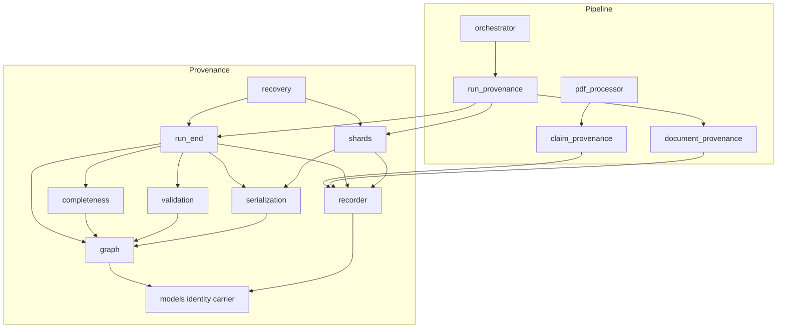
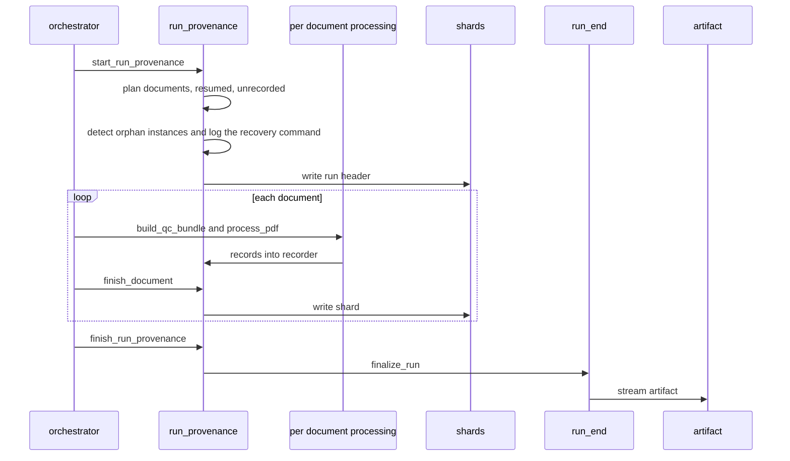
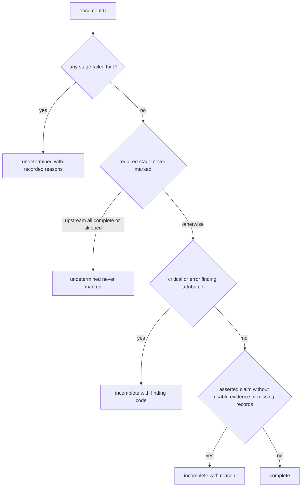
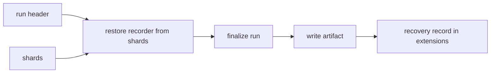

# Design Document — provenance-schema-v2

## Overview

**Purpose**: This feature delivers one deliberate provenance release, schema `evitrace/provenance-graph` **2.0.0**, and the behaviour that makes the artifact credible for audit: stage status and the stage-contract table are in the artifact; completeness degrades for forgotten stages and for serious findings; absence-valued answers are typed (`not_reported`, `absence_like`, `ids_cited`/`no_ids`) and counted instead of read as unsupported; provenance never alters extraction (the exhaustion-retain path is removed); the evidence the model could see is recorded as derivation steps; a run has a run-instance identity and its own directory; every finished document is made durable as a shard and a crashed run can be recovered; the artifact is written by a streaming, byte-identical writer; and privacy carriers have an attach path.

**Users**: auditors and reviewers reading `provenance_graph.json`; operators running large corpora; maintainers of `provenance-audit-export`, `reviewer-ui`, `public-private-provenance`, `privacy-core`, `cost-and-run-reporting`, `evidence-routing`, `multiagent-extraction`, `evaluation-harness`.

**Impact**: Changes `src/provenance/` (models, identity, contracts, recorder, graph, validation, completeness, serialization, claim and identity adapters, privacy carrier) and adds three modules to it (`shards.py`, `run_end.py`, `recovery.py`); changes `src/pipeline/{pdf_processor,claim_provenance,document_provenance,run_provenance,orchestrator}.py` and one accessor use in `evidence_index.py`. It changes the artifact layout (an instance directory), the completeness semantics, and removes one behaviour (retention at exhaustion). It adds no configuration key, no third-party dependency and no prompt text. Version 1.0.0 is treated as never released: there is no converter and the reader supports major 2 only.

Every statement about existing code was checked against HEAD `c21c929` (research M1-M13). Measured facts are in `research.md`; names of `extraction-contract-hardening` interfaces follow its amended design (research M2) and are Assumption A10 until that spec is implemented.

### Goals

- A self-interpretable 2.0.0 artifact: stage status, stage-contract table, run-level extensions, resumed documents, typed claims, absence counts.
- Completeness that cannot read `complete` after a forgotten stage or an unexplained critical/error finding, and that does not turn legitimate absence answers into gaps.
- Observer purity: provenance on and off give identical extraction results, manifest and model calls.
- Durability: nothing a finished document contributed is lost to a crash, an out-of-memory kill or a failed run-end step.
- A write path whose encoding memory does not grow with the corpus and whose bytes equal the complete encoding.
- Determinism everywhere (artifact, shards, recovery).

### Non-Goals

- Privacy classification or disclosure decisions; export formats; the reviewer interface; the extraction contract; fixing cross-invocation resume; tolerance policies for bad evidence ids; incremental reading of a very large artifact.
- Eliding structural edges or cited-only evidence (rejected by the owner; not reopened).
- Per-document (sharded) analysis at run end (research D23).

## Boundary Commitments

### This Spec Owns

- **The 2.0.0 artifact**: schema constants, top-level keys and order, the stage-status object, run-level extensions, resumed documents, the claim and carrier fields, the completeness counts, the compatibility rule and the reader's behaviour for unknown keys.
- **Stage semantics**: the `skipped` status, status precedence, the `evidence_selection` stage, the never-marked rule and its definition of "upstream".
- **Completeness policy**: findings-to-level attribution, counts, empty-run reason, and the statement that the validation report and completeness cannot disagree.
- **Claim classification** from the persisted marks (`nr_origin`, `absence_like`): `answer`, `absence`, origin mapping, the findings `absence_without_ids` and `cited_evidence_not_shown`.
- **Evidence lineage emission** (the steps, their inputs, removal reasons, the digest extension) and the failure reasons of failed documents.
- **Run-instance identity**, the configuration-fingerprint scope, the instance-directory layout, the no-overwrite guard.
- **Durability**: recorder accessors and per-document index, run header, shards, `finalize_run`, explicit recovery, orphan detection.
- **The streaming writer** and its contract.
- **The privacy attach path**: `attach_carriers`, `decision_id`, the carrier-source hook.
- The tests, goldens, guard updates and documents named in the File Structure Plan.

### Out of Boundary

- Anything under `src/pipeline/` that is not a provenance wiring point: validation rules, shown-set computation, prompts, selection, serialisation of evidence, the evidence cache format, the manifest. `pdf_processor.py` is edited only at the exhaustion block, the failure-reason sites, the lineage and skip-mark call sites and `claims.emit`.
- Privacy label vocabulary and policy; which node kinds receive which carrier (`privacy-core`).
- Audit packages and export (`provenance-audit-export`), including how it reads a multi-gigabyte artifact.
- `cost-and-run-reporting`'s resume decision and persisted output path; this feature only reads the same resume test (`pdf_processor.is_resumed`).
- The evidence-routing and multiagent stages; they extend the stage tables later.

### Allowed Dependencies

- `provenance` imports only the standard library and `utils` (in practice `utils.logging_utils`); each module imports only modules before it in the order `privacy_carrier → models → identity → contracts → recorder → graph → validation → completeness → projection → serialization → shards → run_end → recovery`, with `adapters/` after `models`/`identity`/`privacy_carrier`.
- `pipeline` is the only integrator and may import `provenance`; `quality_control`, `agents`, `pdf_extractor`, `text_processing` must not import it.
- `pipeline.claim_provenance` may import `pipeline.shown_evidence` (stdlib leaf) and `pipeline.validator` constants (`EXTRACTION_CONTRACT_VERSION`, `NR_ORIGINS`); `pipeline.document_provenance` may import `pipeline.validator` constants. `provenance` never imports them: the origin-mark vocabulary is mirrored in the claim adapter and pinned equal by a pipeline-side test.
- No new third-party dependency; `hashlib` stays confined to `identity.py`: the writer's and the shard store's digests use `identity.StreamDigest` and `identity.derive_bytes_digest` (new, same module; the finisher is `finish()`), so the 7.1 hashing guard keeps its single allowed module.

### Revalidation Triggers

- Any change to a top-level key, a record field, a vocabulary member or a finding code of the artifact: `provenance-audit-export`, `reviewer-ui`, `public-private-provenance`, `evaluation-harness`.
- The claim-count keys or their invariants: `evaluation-harness` (asserted-only denominators), `provenance-audit-export`.
- The instance-directory layout or `provenance_graph.json` location: `provenance-audit-export`, `reviewer-ui`, `cost-and-run-reporting`.
- `STAGE_ORDER` or `STAGE_CONTRACTS` (here: `evidence_selection` added after `evidence_index`): `evidence-routing`, `multiagent-extraction`.
- `attach_carriers`, `PrivacyCarrier.decision_id`, the `carrier_source` hook: `privacy-core`, `public-private-provenance`.
- The shard or run-header format: recovery, `provenance-audit-export` (pointers).
- Names consumed from `extraction-contract-hardening` (`ShownEvidence`, `shown_evidence`, `nr_origin` vocabulary, `absence_like`, `prefill_source`, `EXTRACTION_CONTRACT_VERSION`): this spec.
- `pdf_processor.is_resumed`: `cost-and-run-reporting` resume gate.

## Architecture

### Existing Architecture Analysis

- `ProvenanceRecorder` is the append-only sink; its only read surface is `snapshot()` (three per-document callers: `run_provenance.py:404`, `evidence_index.py:1143`, `document_provenance.py:413`).
- `build_graph` derives structural edges and failed-stage segments; `validate_chain` and `compute_completeness` read the graph and the snapshot; completeness never reads findings and skips every stage whose status is not `complete`.
- `write_graph` encodes the entire `json.dumps(indent=2)` text before touching the filesystem.
- `process_pdf` emits claims after the output file and manifest are written; the model-visible evidence is not recorded; `RepairRetryLoop.extract_with_repair` retains reference-only exhausted outputs when a provenance sink exists.
- The run-end sequence lives in `pipeline/run_provenance._finish`; `pipeline/__init__` imports the orchestrator (heavy), so a recovery tool cannot live in `pipeline`.
- Constraints preserved: `_shared_paper_prefix` untouched; no global mutation; dependency direction; heavy dependencies lazy.

### Architecture Pattern & Boundary Map



**Architecture Integration**:
- Selected pattern: durable per-document units plus in-memory assembly plus an assembly function shared by the normal path and recovery (research pattern B).
- Domain boundaries: *record definition* (models, identity, carrier), *emission* (recorder, adapters, pipeline wiring), *assembly* (graph), *analysis* (validation, completeness), *persistence* (serialization, shards), *orchestration of the end of a run* (run_end, recovery). The pipeline decides what to record and when a document ends; the provenance package decides how it is stored, assembled and judged.
- Existing patterns preserved: frozen records, closed vocabularies, single-owner attribution in `graph.py`, atomic write via temporary file, additive stage tables.
- New components: `shards.py`, `run_end.py`, `recovery.py` (provenance); everything else extends an existing module.
- Steering compliance: dependency direction, no global mutation, never abort extraction, `CHANGELOG` entry.

### Technology Stack

| Layer | Choice / Version | Role in Feature | Notes |
|-------|------------------|-----------------|-------|
| Runtime | Python 3.12, standard library (`json`, `hashlib`, `os`, `dataclasses`, `argparse`) | All new code | No new dependency |
| Persistence | UTF-8 JSON, two-space indent, atomic temporary-file replace | Artifact, shards, run header | Same discipline as the v1 artifact and `save_manifest` |
| Tests | pytest, Hypothesis (already required) | Unit, property, differential, crash simulation | `xfail(strict=True)` test-first convention from the hardening spec |

## File Structure Plan

### Directory Structure

```
src/provenance/
├── privacy_carrier.py        # PrivacyCarrier.decision_id; conformance rule
├── models.py                 # StageStatus+skipped, ClaimAnswer, AbsenceState, ClaimOrigin+pipeline, StageEntry, StagesRecord,
│                             #   ArtifactReference, ResumedDocument, ClaimCounts, DocumentRecords; RunIdentity.run_instance_id;
│                             #   ClaimNode.answer/absence; CompletenessReport counts; RecordedRun skip/extension fields; new finding codes
├── identity.py               # derive_run_instance_id, instance_directory_name, source_scope_of, derive_bytes_digest, StreamDigest (update/finish)
├── contracts.py              # evidence_selection stage (STAGE_CONTRACTS + STAGE_ORDER), declared in the task that makes the pipeline mark it
├── recorder.py               # mark_stage_skipped, all-reason run-wide failures, run/get_node/has_source/document_stage_status/
│                             #   document_records accessors, per-document index, constructor context
├── graph.py                  # schema 2.0.0, ProvenanceGraph.extensions/stages/resumed_documents, attach_stages, attach_carriers,
│                             #   CarrierConflictError, claim_absence_state (shared rule), _scope_of delegates to identity
├── validation.py             # absence_without_ids, cited_evidence_not_shown, unsupported only for asserted claims
├── completeness.py          # skipped, never-marked rule, finding attribution, counts, empty-run reason
├── serialization.py          # 2.0.0 shape and decoder, streaming two-pass write_graph, ArtifactConflictError
├── shards.py                 # NEW: run header + shard format, atomic write/read, listing, file digests, restore_recorder
├── run_end.py                # NEW: finalize_run (the single run-end sequence), CarrierSource
├── recovery.py               # NEW: recover_instance (liveness guard, --force, --replace), find_orphan_instances, CLI main; NOT exported from __init__
└── adapters/
    ├── claim_adapter.py      # answer/absence/origin from persisted marks; per-field origin
    └── identity_adapter.py   # run_instance_id; corpus identities for an empty run

src/pipeline/
├── claim_provenance.py       # lineage emission, failure reasons, skip marks, header_citations via prefill_source
├── pdf_processor.py          # retain path removed, RepairRetryLoop.exhaustions, lineage/skip/failure call sites
├── document_provenance.py    # run plan (resumed, unrecorded), identity_config scope, pointer discovery, accessor use
├── run_provenance.py         # instance directory, run header, finish_document (per-fingerprint lock), orphan detection and logging, delegation to finalize_run
├── orchestrator.py           # finish_document call, local_config/manifest passed on
└── evidence_index.py         # recorder.run accessor instead of snapshot() (one line)

tests/
├── helpers/provenance_v2_helpers.py                          # NEW graph/recorder/shard builders, stage-mark helper, fake run folder
├── fixtures/provenance/artifact_1_0_0.json                   # NEW: written by the unchanged v1 writer in task 1.1
├── fixtures/provenance/artifact_2_0_0_golden.json            # NEW: pinned 2.0.0 artifact
└── src/
    ├── provenance/
    │   ├── test_provenance_schema_v2.py                      # NEW golden, version guard, v1 refusal, key order, unknown keys
    │   ├── test_provenance_models_v2.py                      # NEW records and vocabularies
    │   ├── test_provenance_stages_v2.py                      # NEW skipped status, precedence, stages record
    │   ├── test_provenance_completeness_policy.py            # NEW never-marked, findings, attribution table, consistency
    │   ├── test_provenance_absence.py                        # NEW answer/absence/origin, findings, counts, properties
    │   ├── test_provenance_lineage_checks.py                 # NEW cited_evidence_not_shown
    │   ├── test_provenance_recorder_accessors.py             # NEW accessors, index agreement with graph attribution
    │   ├── test_provenance_streaming_write.py                # NEW equality, two-pass contract, failures, memory
    │   ├── test_provenance_shards.py                         # NEW format, determinism, restore, atomicity
    │   ├── test_provenance_recovery.py                       # NEW recovery, CLI, orphan detection, refusal
    │   ├── test_provenance_carriers_attach.py                # NEW attach_carriers and decision_id
    │   └── test_provenance_run_end.py                        # NEW finalize_run sequence, carrier phases, degradations
    └── pipeline/
        ├── test_provenance_observer_purity.py                # NEW differential on/off, failed documents, reasons
        ├── test_provenance_evidence_lineage.py               # NEW selection/mitigation/call steps, failure paths, skipped
        ├── test_provenance_run_lifecycle.py                  # NEW header, shards per document, resumed, empty run, pointers
        ├── test_provenance_crash_recovery.py                 # NEW crash simulation and equality with the normal path
        └── test_provenance_contract_consistency.py           # NEW mirrored vocabularies vs hardening constants
```

### Modified Files

- `src/provenance/*.py` and `adapters/*` as above.
- `src/provenance/__init__.py` — export the new public names (`attach_carriers`, `attach_stages`, `finalize_run`, `ResumedDocument`, `StagesRecord`, ...); `recovery` is deliberately not imported there, so `python -m provenance.recovery` does not import its own module twice.
- `src/pipeline/{claim_provenance,pdf_processor,document_provenance,run_provenance,orchestrator,evidence_index}.py` — as above.
- Existing tests: the 8 retain-path tests, 40 completeness-fixture tests, 3 finding tests, the `RunIdentity`/`ClaimNode`/`ProvenanceGraph`/`PrivacyCarrier` construction sites, key-order and version-literal tests, the 7.1/7.2/7.3/7.4 guards (Migration).
- Documents: `src/provenance/README.md`, `src/pipeline/README.md`, `configs/README.md`, `src/utils/README.md` (artifact path), `.kiro/steering/{config,testing,product,roadmap}.md`, `CLAUDE.md`, `README.md`, `CHANGELOG.md`, and dated revision notes in `.kiro/specs/provenance-core/{requirements,design,tasks}.md`.

## System Flows

### Run lifecycle



Key decisions: the run header is written before any document starts; a shard is written for every document that had provenance (success, failure or unhandled error) from a `finally` in `_bounded`; the run-end function is the same one recovery calls.

### Completeness decision for one document



Claims follow the same order at claim level; absence-valued claims skip the support branch. `undetermined` outranks `incomplete` in aggregation, as before.

### Recovery



## Requirements Traceability

| Requirement | Summary | Components | Interfaces | Flows |
|-------------|---------|------------|------------|-------|
| 1.1-1.3, 1.8 | Version 2.0.0; major 2 only; no converter; golden and refusal tests | ArtifactSerialization | `PROVENANCE_SCHEMA_VERSION`, `SUPPORTED_SCHEMA_MAJORS`, `UnrecognizedSchemaVersionError` | - |
| 1.4-1.7, 1.9, 1.10 | Key order, unknown-key preservation, compatibility rule, writer version stamp, extension-key validation, documented additions | ArtifactSerialization, Docs | `graph_to_dict`, `graph_from_dict` | - |
| 2.1-2.8 | Stage status in the artifact (explicit `not_run`), skipped (positive knowledge only), precedence, final status, shared status of identical-content documents | StageTables, RecorderV2, GraphAssembly | `StagesRecord`, `mark_stage_skipped`, `attach_stages` | Run lifecycle |
| 3.1-3.4 | Never-marked rule (suppressed by any failed stage), skipped handling, run-scoped stage | CompletenessPolicy | `compute_completeness` | Completeness decision |
| 3.5-3.9, 3.12 | Findings degrade by effective severity; attribution; consistency; overrides recorded | CompletenessPolicy, RunEnd | attribution table, `x-pipeline-severity_overrides` | Completeness decision |
| 3.10 | Fail-run severity independent | RunLifecycle | `ProvenanceRunSummary` | - |
| 3.11 | Same-content PDFs | CompletenessPolicy, RunLifecycle | `duplicate_identity` attribution | - |
| 4.1-4.6, 4.10 | Typed answers, marks, origin mapping, findings | ClaimClassification, ChainChecks, SchemaVocabulary | `claim_nodes_from_fields`, `claim_absence_state` | - |
| 4.7-4.9, 4.12, 4.13 | Claim-level completeness of absence-valued claims; counts; support `not_applicable` | CompletenessPolicy | `ClaimCounts` | Completeness decision |
| 4.11 | Coverage indicator | CompletenessPolicy, RunLifecycle | `below_coverage` | Run lifecycle |
| 5.1-5.2, 5.7 | Observer purity; exhaustion fails the document | ObserverBoundary | `RepairRetryLoop.extract_with_repair` | - |
| 5.3-5.5 | Failed-stage reasons | ObserverBoundary | `RepairRetryLoop.exhaustions`, `bounded_reason` | - |
| 5.6 | Accepted-output reference issues | ClaimClassification, ObserverBoundary | issue sink | - |
| 6.1-6.2, 6.6-6.9 | Selection and mitigation steps; skipped/failed; failure paths; no prompt change | EvidenceLineage | `emit_evidence_lineage` | Run lifecycle |
| 6.3-6.5 | Call steps with shown inputs and digest; cited-outside check | EvidenceLineage, ChainChecks | `cited_evidence_not_shown` | - |
| 6.10 | Growth estimate documented | Docs | - | - |
| 7.1-7.2, 7.4-7.6 | Run-instance identity, directory, guard, documentation | IdentityV2, ArtifactSerialization, RunLifecycle | `derive_run_instance_id`, `ArtifactConflictError` | Run lifecycle |
| 7.3 | Fingerprint scope | RunLifecycle | `identity_config` | - |
| 8.1-8.7 | Resumed, unrecorded, empty runs; completeness scope | RunLifecycle, GraphAssembly | `ResumedDocument`, `ArtifactReference` | Run lifecycle |
| 9.1-9.10 | Header, shards, atomicity, determinism, failure handling, per-fingerprint serialisation, safe file names | ShardStore, RecorderV2, RunLifecycle | `write_run_header`, `write_shard`, `document_records` | Run lifecycle |
| 10.1-10.8 | Recovery (explicit only), orphan detection and logging, liveness guard | Recovery, RunEnd | `recover_instance`, `find_orphan_instances` | Recovery |
| 11.1-11.5 | Streaming two-pass write | ArtifactSerialization | `write_graph` | - |
| 11.6 | No per-document snapshots | RecorderV2, RunLifecycle | `ProvenanceRecorder.run`, `get_node`, `has_source`, `document_stage_status` | - |
| 11.7 | Documented sizes | Docs | - | - |
| 12.1-12.10 | Carrier attach path | GraphAssembly, SchemaVocabulary, RunEnd | `attach_carriers`, `PrivacyCarrier.decision_id`, `CarrierSource` | Run lifecycle |
| 13.1-13.4 | Determinism | ArtifactSerialization, ShardStore, RunEnd | sorted encoders | - |
| 14.1-14.3 | Never abort | RunLifecycle, RunEnd | degradation list | - |
| 15.1-15.4 | Prompt stability, boundaries, guards | all, TestsAndGuards | drift inventories | - |
| 16.1-16.5 | Verification | TestsAndGuards | - | - |
| 17.1-17.4 | Change record and notifications | Docs | - | - |

## Components and Interfaces

| Component | Domain/Layer | Intent | Req Coverage | Key Dependencies (P0/P1) | Contracts |
|-----------|--------------|--------|--------------|--------------------------|-----------|
| SchemaVocabulary | Definition | New records, vocabularies, carrier field | 1, 2, 4, 7, 8, 12 | privacy_carrier (P0) | State |
| IdentityV2 | Definition | Run-instance id, instance directory name, shape rule | 7 | models (P0) | Service |
| StageTables | Definition | `evidence_selection` stage | 6, 15 | models (P0) | State |
| RecorderV2 | Emission | Skipped status, accessors, per-document records | 2, 9, 11 | identity (P0), contracts (P0) | Service, State |
| GraphAssembly | Assembly | 2.0.0 graph, stages, extensions, carriers | 1, 2, 8, 12 | recorder (P0) | Service |
| ClaimClassification | Emission | answer/absence/origin from marks | 4 | identity (P0) | Service |
| ChainChecks | Analysis | New findings, asserted-only unsupported | 4, 6 | graph (P0) | Service |
| CompletenessPolicy | Analysis | Never-marked, findings, counts | 3, 4, 8 | graph (P0), validation report (P1) | Service |
| ArtifactSerialization | Persistence | 2.0.0 shape, streaming writer, guard | 1, 7, 11, 13 | graph (P0) | Batch, State |
| ShardStore | Persistence | Header and shard files, restore | 9, 13 | serialization (P0), recorder (P0) | Batch, State |
| RunEnd | Orchestration | Single run-end sequence | 3, 7, 10, 12, 14 | all analysis (P0) | Service |
| Recovery | Orchestration | Assemble from shards; CLI | 10 | shards (P0), run_end (P0) | Batch |
| ObserverBoundary | Integration | Retain path removal, failure reasons | 5 | pdf_processor (P0) | Service |
| EvidenceLineage | Integration | Selection, mitigation, call steps, skip marks | 2, 6 | claim_provenance (P0), hardening shown set (P0) | Service |
| RunLifecycle | Integration | Plan, header, shards per document, finish | 7, 8, 9, 14 | run_end (P0), shards (P0) | Service, State |
| Docs | Documentation | READMEs, steering, CHANGELOG, revision and upstream notes | 1, 5, 6, 11, 17 | - | - |
| TestsAndGuards | Verification | Goldens, differential, crash simulation, guard updates | 15, 16 | all (P0) | - |

### Definition and emission (provenance package)

#### SchemaVocabulary and IdentityV2

**Contracts**: State [x] / Service [x]

```python
# models.py (additions; existing names kept)
StageStatus   = Literal["not_run", "complete", "failed", "skipped"]
ClaimAnswer   = Literal["asserted", "not_reported", "absence_like"]
AbsenceState  = Literal["not_applicable", "ids_cited", "no_ids"]
ClaimOrigin   = Literal["model", "prefill", "pipeline", "human", "import"]   # + "pipeline"
ClaimSupport  = Literal["supported", "unsupported", "missing_anchor", "not_applicable"]   # + "not_applicable"

@dataclass(frozen=True)
class RunIdentity(_Record):                      # run_instance_id declared right after run_id, required
    run_id: str
    run_instance_id: str
    config_fingerprint: str; schema_fingerprint: str
    model_ids: tuple[str, ...]; document_fingerprints: Mapping[str, str]; created_at: str

@dataclass(frozen=True)
class ClaimNode(ProvenanceNode):                 # appended after confidence, Python defaults only
    ...; confidence: str | None
    answer: ClaimAnswer = "asserted"
    absence: AbsenceState = "not_applicable"

@dataclass(frozen=True)
class StageEntry(_Record):    status: StageStatus; reasons: tuple[str, ...] = ()
@dataclass(frozen=True)
class StagesRecord(_Record):  order: tuple[str, ...]; contracts: tuple[StageContract, ...]
                              run: Mapping[str, StageEntry]; documents: Mapping[str, Mapping[str, StageEntry]]
@dataclass(frozen=True)
class ArtifactReference(_Record): path: str; sha256: str; run_instance_id: str
@dataclass(frozen=True)
class ResumedDocument(_Record):
    document_key: str; source_id: str; output_path: str | None; extraction_contract: str | None; reason: str
    earlier_artifact: ArtifactReference | None = None; earlier_shard: ArtifactReference | None = None
@dataclass(frozen=True)
class ClaimCounts(_Record):
    claims: int; asserted: int; supported: int; missing_anchor: int; unsupported: int
    absence_like: int; ids_cited: int; no_ids: int; pipeline_produced: int; human: int
    below_coverage: bool | None = None
@dataclass(frozen=True)
class DocumentRecords(_Record):                  # cross-layer: recorder produces it, shards persist it
    source_id: str; nodes: tuple[ProvenanceNode, ...]; edges: tuple[ProvenanceEdge, ...]
    findings: tuple[ValidationFinding, ...]; stages: Mapping[str, StageEntry]; below_coverage: bool | None = None
# ArtifactCompleteness gains: scope: Literal["full", "partial"] | None = None   (set on the run entry only)
# CompletenessReport gains: run_counts: ClaimCounts | None = None; document_counts: Mapping[str, ClaimCounts] = {}
# RecordedRun gains: stage_skip_reasons, document_stage_skip_reasons, extensions, resumed_documents (all defaulted);
#   stage_failure_reasons becomes Mapping[str, tuple[str, ...]] (every distinct reason, recording order)
# DEFAULT_SEVERITIES gains: "absence_without_ids": "info", "cited_evidence_not_shown": "error"

# privacy_carrier.py
@dataclass(frozen=True)
class PrivacyCarrier: state; label; decision; decision_id: str | None = None; supplied_by; supplied_at; rejection_reason
# input shape {label, decision?, decision_id?}; decision_id requires decision; both stored verbatim; extra keys rejected

# identity.py
RUN_INSTANCE_ID_PREFIX = "inst:"
def derive_run_instance_id(run_id: str, document_fingerprints: Mapping[str, str], created_at: str) -> str   # "inst:<sha256[:16]>"
def instance_directory_name(run_instance_id: str) -> str                                                       # "inst-<16 hex>"
def source_scope_of(identifier: str) -> str | None        # the src: scope of source, evidence and claim identifiers
def derive_bytes_digest(data: bytes) -> str               # sha256 hex; keeps hashlib inside identity.py
class StreamDigest:                                       # incremental sha256: update(data: bytes), finish() -> str
```

- Invariants: `derive_run_instance_id` digests the sorted fingerprint values with the canonical digest helper, so equal inputs give equal ids and document order never matters. `graph._scope_of` delegates to `source_scope_of`. The origin-mark vocabulary is mirrored in the claim adapter, not imported.
- `ClaimSupport.not_applicable` is the support of a not-reported or absence-like claim that cites no evidence node (research D27: consumers that ignore `answer` must not re-read the W1 mislabel); `unsupported` is reserved for asserted claims.
- Field defaults on `ClaimNode`/`CompletenessReport`/`ArtifactCompleteness` exist only so construction sites stay readable; the artifact always writes them (explicit over derived).

#### StageTables

`contracts.py`: `StageContract(stage="evidence_selection", required_record_kinds=("derivation",), scope="document")` inserted in `_CONTRACT_ROWS`; `"evidence_selection"` inserted in `STAGE_ORDER` immediately after `"evidence_index"`. Eight stages result. **The declaration is made in the same task that makes the pipeline mark the stage** (task 8.4), together with the drift-guard core-stage list and the contract tests: declaring it earlier would make the never-marked rule flag a stage no emitter marks yet (measured: 50 failures in the provenance modules with the stage declared and the rules active, research M4). Test fixtures that mark every stage iterate `STAGE_ORDER`, so adding a stage does not break them. The stage is listed among the 2.0.0 additions (Requirement 1.7); the stage tables are open for extension without a version change, as before.

#### RecorderV2

**Contracts**: Service [x] / State [x]

```python
class ProvenanceRecorder:
    def __init__(self, run: RunIdentity, *, enabled: bool = True,
                 extensions: Mapping[str, Any] | None = None,
                 resumed_documents: Sequence[ResumedDocument] = ()) -> None: ...
    @property
    def run(self) -> RunIdentity: ...
    def get_node(self, node_id: str) -> ProvenanceNode | None: ...
    def has_source(self, source_id: str) -> bool: ...
    def document_stage_status(self, source_id: str) -> Mapping[str, StageEntry]: ...   # marked stages only
    def document_records(self, source_id: str, *, below_coverage: bool | None = None) -> DocumentRecords: ...
    def mark_stage_skipped(self, stage: str, reason: str, *, source_id: str | None = None) -> None: ...
```

- `RecordedRun.stage_failure_reasons` changes from a first-reason string to a tuple of every distinct reason. The source edits this requires are part of the recorder task: `graph._failed_stage_segments` (it calls `.strip()` on the reason and would silently report "no reason recorded" for a tuple) and `completeness._Analysis._normalize_status`/`failed_stages` (they keep only `str` values and would silently drop tuples); both are updated together with their tests.
- Status precedence `not_run < skipped < complete < failed`; a mark never lowers a status (a skip after complete is ignored with a DEBUG log; skip then complete becomes complete). Reasons: every distinct failure or skip reason is kept in recording order, run-wide and per document.
- Per-document index: at record time each node is bucketed by `source_scope_of` (source node: its own id; evidence/claim: `source_id`; derivation step: every scope found in its input and output ids); an edge by its `from_id`'s scope; a finding by its `node_id`'s buckets, else `details["source_id"]`, else its `edge_id`'s `from_id` scope. Buckets hold identifiers only; `document_records` builds sorted tuples in O(document size) under the lock.
- `enabled=False` keeps its no-op contract; the accessors then return empty values.
- Dependency: `identity.source_scope_of` only; the recorder does not import `graph`.

#### GraphAssembly

```python
PROVENANCE_SCHEMA_VERSION = "2.0.0"
@dataclass(frozen=True)
class ProvenanceGraph(_Record):          # existing fields first; then, all defaulted:
    extensions: Mapping[str, Any] = {}   # run-level; keys x-<ns>-<field>
    stages: StagesRecord | None = None
    resumed_documents: tuple[ResumedDocument, ...] = ()
def build_graph(recorded: RecordedRun) -> ProvenanceGraph        # also fills extensions, stages, resumed_documents
def attach_stages(graph: ProvenanceGraph, recorded: RecordedRun) -> ProvenanceGraph
def attach_carriers(graph: ProvenanceGraph, carriers: Mapping[str, PrivacyCarrier], *,
                    allow_rejected: bool = True) -> ProvenanceGraph
def claim_absence_state(claim: ClaimNode, nodes: Mapping[str, ProvenanceNode]) -> AbsenceState
class CarrierConflictError(ValueError): ...                      # names node ids only, never carrier values
```

- `attach_stages` rebuilds `StagesRecord` from a (post-validation) snapshot: `order` = `STAGE_ORDER`, `contracts` = `STAGE_CONTRACTS` in order, `run` = one entry per declared stage, `documents` = for every document in `run.document_fingerprints` **one entry per declared stage, `not_run` written explicitly** for unmarked stages (explicit over derived; about 450 bytes per document). `build_graph` leaves `stages` unset until the schema task switches the serializer on, so the graph and its serialisation never disagree between tasks; `attach_stages` is the only producer of `stages` afterwards.
- `ProvenanceGraph` validates the keys of its run-level `extensions` with the same namespaced-key rule as nodes. It is total, non-mutating and idempotent, like `attach_completeness`.
- `attach_carriers`: pure function of its arguments; unknown ids ignored with one WARNING (count and first five ids); equal carrier = no-op; a node whose current carrier is not the unknown carrier and differs from the supplied one raises `CarrierConflictError` before any change (atomic); the comparison is whole-object equality of carriers, never an attribute read of label or decision (the 9.4 scans cover it); all five node kinds accepted. Structurally rejected carriers (`state == "rejected"`) are attachable (so validation reports them) unless the call passes `allow_rejected=False` (used for the post-validation phase), in which case that entry is skipped with a WARNING naming the node.
- `claim_absence_state`: for a claim whose `answer != "asserted"`, `ids_cited` iff at least one id in `cited_evidence_ids` is an evidence node in `nodes`, else `no_ids`; `not_applicable` for asserted. The adapter, the validator and completeness use this one rule (a consistency test compares the adapter's stored value).

#### ClaimClassification (`claim_adapter`)

```python
_NR_ORIGIN_KEY, _ABSENCE_LIKE_KEY = "nr_origin", "absence_like"
_ORIGIN_OF_MARK = {"model": "model", "pipeline_prefill": "prefill", "pipeline_empty_value": "pipeline", "human": "human"}
def claim_nodes_from_fields(fields, *, source_id, run_id, known_evidence_ids, origin, evidence_anchors) -> (claims, edges, findings)
```

- Per field: `nr_origin` present and a known mark → `answer="not_reported"`, origin from the mapping; `absence_like is True` → `answer="absence_like"`, origin from the call; both marks, or an unknown mark → asserted, call origin, WARNING. `absence` per `claim_absence_state` semantics at conversion time (ids resolved against `known_evidence_ids`). `support`: asserted claims as before; an absence-valued claim that is `ids_cited` gets the support computed by the usual anchor rule (`supported` or `missing_anchor`); one that is `no_ids` gets `not_applicable`. The value text is never examined; the digest is of the persisted value as before.
- Findings from reference problems are unchanged (a not-reported claim may still cite a dangling id: critical `dangling_reference`, claim `no_ids`).

#### ChainChecks (`validation.py`)

- `unsupported_claim` / `prefill_unsupported`: only `answer == "asserted"` claims.
- `absence_without_ids` (info): `answer == "not_reported"`, origin `model`, state `no_ids` (recomputed with `claim_absence_state`).
- `cited_evidence_not_shown` (error): for every claim and every non-in-place producing step of kind `extract` or `synthesize` that has at least one evidence node among its inputs, each cited evidence id not among those inputs yields one finding naming the claim (`details`: `reference`, `step`). A step with no evidence inputs (direct callers, other emitters) is not checked.
- `duplicate_identity`, `missing_anchor` etc. are unchanged.

### Analysis

#### CompletenessPolicy

**Contracts**: Service [x]

```python
def compute_completeness(graph, recorded, report=None, *, contracts=STAGE_CONTRACTS,
                         stage_contracts_strict=True,
                         below_coverage: Mapping[str, bool | None] | None = None) -> CompletenessReport
```

- **Effective stage status** per (document, stage): the highest of run-wide and per-document under `not_run < skipped < complete < failed`.
- **Contract diff**: unchanged for `complete` stages; `skipped` and `not_run` require nothing.
- **Never-marked rule**: for each document D and each contract stage S with scope `document` or `claim` whose effective status is `not_run`: if **no stage of D has effective status `failed`** and every contract stage T with `stage_sort_key(T) < stage_sort_key(S)` (the shared attribution ordering, never `STAGE_ORDER.index`) and scope `document` or `claim` has effective status `complete` or `skipped` for D, contribute `undetermined`, reason `stage 'S' was never marked`, responsible stage S. For a run-scoped S (`chain_validation`): when the run has at least one processed document and the run-wide status is `not_run`, contribute `undetermined` to the run. An unmarked stage in a document that has any failed stage, or after a not-run or unmarked upstream stage, contributes nothing: the document is already undetermined with the recorded reasons, and a failure (a write error, an unexpected exception) can legitimately end emission early. Because the pipeline marks `skipped` only where it positively knows a stage does not apply (Requirement 2.5), a silently returning emitter in a document without failures is still reported.
- **Findings**: let `report` be the passed report or `graph.validation`. Each finding whose `severity` is `critical` or `error` contributes `incomplete`, reason `finding:<code>`, at the level chosen by the first applicable rule: (1) `node_id` is a claim → that claim; (2) `node_id` is another node → its document (`document_of`), or every document of a derivation step (`step_documents`); (3) `details["source_id"]` → that document; (4) `edge_id` → the document of its `from_id`; (5) the run. Claim contributions lift to the claim's document through the existing aggregation (prefill-origin claims keep the claim-level-only exception for `unsupported`/`missing_anchor` reasons only).

| Finding code | Default | Attaches to | Degrades |
|---|---|---|---|
| `dangling_reference` | critical | claim (citing) or the node/edge owner | claim, else document |
| `graph_cycle` | critical | smallest member node | claim or document(s) of the member |
| `invalid_identifier` | critical | `details.source_id` document, else node | document |
| `source_not_represented` | error | the evidence or claim node | document of the missing source |
| `evidence_out_of_run_context` | error | claim | claim |
| `inconsistent_derivation` | error | derivation step | its documents, else run |
| `privacy_carrier_invalid` | error | the node | claim, document or run (validation record) |
| `duplicate_identity` | error | the node whose record was dropped | its document (a source node: the shared document) |
| `cited_evidence_not_shown` | error | claim | claim |
| `unsupported_claim`, `prefill_unsupported`, `missing_anchor`, `duplicate_reference`, `ambiguous_reference` | warning | - | never (support gaps are graph-derived) |
| `orphan_node`, `absence_without_ids` | info | - | never |

- **Claims**: `answer in {not_reported, absence_like}` skip the `unsupported`/`missing_anchor` contribution (their `support` is `not_applicable`, `supported` or `missing_anchor`, none of which is a gap); they keep the `missing_records` and "evidence lost to a missing segment" contributions. Asserted claims are unchanged (graph-derived support; not removable by an override).
- **Counts**: over final claims (no incoming `revises` edge). Classification per final claim: asserted → `asserted` plus its support bucket (recomputed from the graph); `absence_like` → `absence_like`; `not_reported` → by origin: `model` → `ids_cited`/`no_ids` via `claim_absence_state`, `prefill` or `pipeline` → `pipeline_produced`, `human` → `human`. Each final claim lands in exactly one of `asserted`, `absence_like`, `ids_cited`, `no_ids`, `pipeline_produced`, `human` (answer first, then origin), and an asserted claim in exactly one support bucket, so nothing is counted twice; hardening's report class `pipeline` corresponds to `pipeline_produced`. `below_coverage` from the supplied mapping (document: its flag or `None`; run: any true → true, all known false → false, else `None`).
- **Scope**: the run entry's `scope` is `partial` when `graph.resumed_documents` is non-empty or `graph.extensions["x-pipeline-unrecorded_documents"]` is non-empty, else `full`; document and claim entries carry `null`. A `complete` run with scope `partial` describes the processed documents only.
- **Empty run reason**: when no document is recorded and `graph.resumed_documents` is non-empty the run reason is `no document was processed in this run; N resumed document(s) are listed in resumed_documents` (plus the unrecorded count from `graph.extensions["x-pipeline-unrecorded_documents"]` when present); otherwise the existing text.
- The module docstring loses any statement that findings are ignored.

### Persistence

#### ArtifactSerialization

**Contracts**: Batch [x] / State [x]

```python
ARTIFACT_FILENAME = "provenance_graph.json"
SUPPORTED_SCHEMA_MAJORS: tuple[int, ...] = (2,)            # derived from the writer's major as before
class ArtifactConflictError(FileExistsError): ...          # names the existing path and both run-instance ids
def graph_to_dict(graph) -> dict                           # keys in the 2.0.0 order
def iter_artifact_text(graph) -> Iterator[str]             # the piecewise encoding
def write_graph(graph, path: Path) -> Path                 # directory = the instance directory
```

- **Writer version**: `graph_to_dict` always writes `PROVENANCE_SCHEMA_VERSION`; `ProvenanceGraph.schema_version` is informational (the version the graph was read with), so a rewrite of an artifact whose unknown keys were relocated into the extensions never claims a newer minor.
- **Keys, in order**: `schema_id, schema_version, run, extensions, stages, resumed_documents, nodes, edges, missing_segments, validation, completeness`. The decoder iterates the dataclass fields; `stages`, `extensions`, `resumed_documents` are required keys in 2.x; an unknown top-level key is preserved as `extensions["x-compat-unknown"]` (first free key `x-compat-unknown_2`, ...) with one WARNING; unknown keys in the run record, the stage-status object, the claim counts, segments, report containers and completeness entries are named in one WARNING, dropped, and the warning says that adding keys there requires a major version; run-level extension keys that do not follow the namespaced pattern are relocated under the compatibility key like node-level ones.
- **Compatibility rule (stated in the module docstring and the README)**: a minor release may add keys where a free-form slot exists or at top level (older 2.x readers keep them in `extensions`); a major release is required to add a key to any record without a free-form slot (the run identity, the stage-status object, the claim counts, completeness entries, missing segments, report containers), to add or remove a vocabulary member, to rename or remove a key, or to change a key's meaning.
- **Writer (two-pass)**: `iter_artifact_text` yields the exact text of `json.dumps(graph_to_dict(g), indent=2, ensure_ascii=False, allow_nan=False) + "\n"` piece by piece: the opening brace, each top-level key, each node and each edge/segment encoded alone with `json.dumps(..., indent=2)` and re-indented by two spaces per nesting level (valid because JSON string escapes contain no raw newline; empty containers print `[]`/`{}`). Pass 1 iterates it, discards text, counts bytes and hashes with `identity.StreamDigest` (`update(data)` / `finish()`; the finisher is not named `hexdigest` so the hashing guard's pattern stays confined to `identity.py`) and raises on non-finite or unrepresentable values **before any directory or file exists**. Pass 2 writes the temporary file in the target directory, flushes, `fsync`s, compares its digest to pass 1 and `os.replace`s; any exception removes the temporary file and leaves the previous artifact. Before pass 2 the guard compares the existing target, if any: it reads at most the first 4,096 bytes and extracts `"run_instance_id"`; a missing file is fine, the same instance is replaced (an identical rewrite or a recovery), a different, unreadable or foreign file raises `ArtifactConflictError` and nothing is written.
- Memory: the encoding transient is one record's JSON text; `graph_to_dict` for the whole graph is no longer built by `write_graph`.
- `read_graph` is unchanged in method (it loads the file).

#### ShardStore

**Contracts**: Batch [x] / State [x]

```python
SHARD_SCHEMA_ID = "evitrace/provenance-shard"            ; SHARD_SCHEMA_VERSION = "1.0.0"
RUN_HEADER_SCHEMA_ID = "evitrace/provenance-run-header" ; RUN_HEADER_SCHEMA_VERSION = "1.0.0"
RUN_HEADER_FILENAME = "run.json" ; SHARD_DIRNAME = "shards"
@dataclass(frozen=True) class RunHeader: run: RunIdentity; extensions: Mapping[str, Any]; resumed_documents: tuple[ResumedDocument, ...]
def write_run_header(instance_dir: Path, header: RunHeader) -> Path
def read_run_header(instance_dir: Path) -> RunHeader
def write_shard(instance_dir: Path, run: RunIdentity, records: DocumentRecords) -> Path      # shards/<fingerprint>.json
def read_shard(path: Path) -> ShardFile                                                      # run ids + DocumentRecords
def list_shards(instance_dir: Path) -> tuple[Path, ...]
def file_reference(path: Path, base: Path, run_instance_id: str) -> ArtifactReference
def restore_recorder(header: RunHeader, shards: Sequence[ShardFile]) -> ProvenanceRecorder
class MalformedShardError(ValueError): ...
```

- **Shard content** (Requirement 9.3): `{schema_id, schema_version, run_id, run_instance_id, source_id, below_coverage, nodes, edges, findings, stages}` with nodes sorted by id, edges by id, findings by id, stages in `STAGE_ORDER`, each stage `{status, reasons}`. No clock value, no run-level data. Structural edges are not stored (derived at assembly).
- **File name** is the document fingerprint (the part of `source_id` after `src:`), so equal documents map to one file. The identity shape check only forbids `#` and whitespace, so `shard_filename` additionally accepts only `[A-Za-z0-9]{1,128}` (a path separator or dot segment would otherwise escape the shard directory) and raises `InvalidIdentifierError` otherwise.
- **Atomic write**: temporary file next to the target, flush, `fsync`, `os.replace`; failure removes the temporary file. Equal records give equal bytes.
- **Restore**: replays the records through the public recorder API (`record_source/evidence/claim/derivation/validation`, `record_issue`, `mark_stage_*` with every reason) so the recorder's own rules apply; recorded edges are attached through `record_claim` by `from_id`; a stray edge is skipped with a WARNING. The recorder is constructed with the header's run, extensions and resumed documents, plus the recovery record.
- Cleanup: never automatic. The README states that an instance directory may be removed as a unit, and that later artifacts' `resumed_documents` references to it then become dangling (the artifact states the path and digest it recorded, so the loss is detectable).

#### RunEnd and Recovery

```python
CarrierSource = Callable[[ProvenanceGraph, Literal["pre_validation", "post_validation"]], Mapping[str, PrivacyCarrier]]
@dataclass(frozen=True)
class RunEndResult: graph: ProvenanceGraph | None; report: ChainValidationReport | None; completeness: CompletenessReport | None
                    artifact_path: Path | None; validated: bool; degradations: tuple[str, ...]
def finalize_run(recorder: ProvenanceRecorder, directory: Path, *, severity_overrides: Mapping[str, Any],
                 stage_contracts_strict: bool, carrier_source: CarrierSource | None = None,
                 below_coverage: Mapping[str, bool | None] | None = None) -> RunEndResult

LIVENESS_THRESHOLD_SECONDS = 1800
def recover_instance(instance_dir: Path, *, carrier_source: CarrierSource | None = None,
                     force: bool = False, replace: bool = False, now: float | None = None) -> RecoveryResult
def find_orphan_instances(provenance_dir: Path, *, exclude: str | None = None) -> tuple[Path, ...]
def main(argv: Sequence[str] | None = None) -> int          # PYTHONPATH=src python -m provenance.recovery <instance_dir> [--force] [--replace] [--carrier-source module:callable]
```

- **`finalize_run` sequence** (each step has its own guard, never raises `Exception`): snapshot → `build_graph` → carriers `pre_validation` → `validate_chain(severity_overrides, recorded_findings)` → `attach_validation` → mark `chain_validation` (complete, or failed with the reason) → carriers `post_validation` (`allow_rejected=False`) → post-validation snapshot → `attach_stages` → `compute_completeness(..., below_coverage)` → `attach_completeness` → `write_graph(directory)`. A carrier-source exception or `CarrierConflictError` is a degradation (WARNING, no carriers from that call). An `ArtifactConflictError` is a degradation (no artifact, WARNING naming both files). With no carrier source the bytes equal those of a run without the hook.
- **Recovery**: reads the header and all shards, rebuilds the recorder, takes the policy from `header.extensions` (`x-pipeline-severity_overrides`, `x-pipeline-stage_contracts_strict`; defaults when absent), sets `below_coverage` from each shard, adds `extensions["x-provenance-recovery"] = {"recovered_from": <dir name>, "shards_used": n, "documents_without_shard": [source ids]}` and calls `finalize_run` with the instance directory. It refuses (`RecoveryError`) when `provenance_graph.json` already exists unless `replace=True` (`--replace`, same run instance only), and when the newest modification time among `run.json` and the shards is within `LIVENESS_THRESHOLD_SECONDS` (30 minutes, documented) of now unless `force=True` (`--force`): a run that is still in progress must not be "recovered" under it. The CLI prints the artifact path and exits 0, or prints the error to stderr and exits 1. It imports no `pipeline` and needs no key.
- **Orphan detection**: a sibling instance directory with `run.json` and without `provenance_graph.json`. A run start only detects them and logs, per directory, `PYTHONPATH=src python -m provenance.recovery <instance_dir>`; nothing is recovered in-process (an automatic recovery could race a live run, and a recovery that itself ran out of memory would take the new run with it).
- Recovery needs the same memory as a normal assembly; it removes the dependence on the dead process, not the cost of the analysis, so it does not help when the analysis itself exceeds memory at very large corpus sizes (stated in the documentation).
- Not recoverable (documented): run-wide stage marks, findings that name no document, carriers attached at run end (re-applied when `--carrier-source module:callable` is given).

### Integration (pipeline)

#### ObserverBoundary

- `RepairRetryLoop.extract_with_repair`: the `# --- Exhaustion ---` retention block is deleted; the exhaustion path always raises `RepairExhaustedError`. `_report_references` stays for accepted outputs. The loop gains `exhaustions: Mapping[tuple[str, int], Mapping[str, Any]]` (read-only view, key `(call_kind, chunk)`, value `{"status", "chunk", "last_error", "error_type", "attempts", "codes"}`), written just before raising; the metadata dict inside `RepairExhaustedError` gains `codes` (ignored by `_failure_record_from_exception`, so manifests are unchanged).
- Failure reasons (`claim_provenance`): `bounded_reason(text, limit=4000)` appends `" ... [N characters omitted]"` when shortening; `extraction_failure_reason(exhaustions, manifest_failures)` returns `"; ".join(f"chunk {n}: {error_type} [codes: {codes}]: {last_error}")` per failed chunk, falling back to the manifest failure record (no codes); `synthesis_failure_reason(exc, exhaustions)` uses `exc.metadata["last_error"]` and codes. `DocumentClaims.mark_failed` stops truncating failure reasons at 200 characters and uses the helper; log lines keep their short form.
- `process_pdf` call sites: extraction failure → `claims.mark_failed("extraction_chunk", extraction_failure_reason(...))`; synthesis failure → `claims.mark_failed("synthesis", synthesis_failure_reason(...))`.

#### EvidenceLineage

**Contracts**: Service [x]

```python
# claim_provenance.py
def emit_evidence_lineage(self, *, bundle, shown_evidence, selection_limits: Mapping[str, int]) -> None
def mark_skipped(self, stage: str, reason: str) -> None
```

- `emit_evidence_lineage` (idempotent, never raises; `process_pdf` calls it from a `finally` that wraps everything from the first model call to the end of the function, so it runs on **every** exit after the first call: an exhausted or failing extraction chunk, a failing synthesis call, a failed output validation or write (`not write_ok`, a raised write error), an unexpected exception in a later step, and success; tests cover each exit): groups the calls in `shown_evidence` by `package_ids`; for each group records one `evidence_selection` step, kind `filter`, deterministic: inputs = the full node ids of the document's index items (`bundle.evidence_items` ids; header metadata nodes excluded), outputs = the group's package ids that are nodes, `removed_ids` = inputs minus outputs, `removal_reason = "selection_cap: paper-level evidence selection (max_items=<n>, max_chars=<m>); item not in the package sent to the model"` (no reason and no removed ids when nothing was removed), extensions `x-pipeline-max_items`, `x-pipeline-max_chars`. For each call whose `withheld_by_mitigation` is non-empty it records a second `filter` step: inputs = package nodes, outputs = the call's shown nodes, removed = withheld nodes, reason `"token_budget: whole evidence items removed before the <call_kind> call"`, extensions `x-pipeline-call_kind`, `x-pipeline-chunk`. Then it marks `evidence_selection` complete; if any call has `package_readable` false it marks the stage failed with `"evidence package of <call_kind> chunk <n> could not be read"` instead. If the document has no evidence items although a model call was made, no empty step is recorded (it would trip `inconsistent_derivation`): the stage is marked failed with `"the document has no evidence items although a model call was made"`. Ids not present as evidence nodes are dropped with a DEBUG count (a step input must be a node). If the shown mapping is empty although the document needed model calls (an exception before the first call), nothing is marked: the stage stays `not_run` and the orchestrator's failure marking or the never-marked rule explains it.
- In `DocumentClaims.emit`: each `extract` step's inputs are the call's shown nodes (not only the cited ones) and each `synthesize` step's inputs are the contributing claim ids plus the synthesis call's shown nodes; both carry `x-pipeline-package_sha256` (and `x-pipeline-chunk` as before). When no shown set exists for a call (direct callers, tests) the inputs are the cited nodes, as in 1.0.0.
- Input tuples are built from the recorded `EvidenceNode.node_id` string objects (shared storage) rather than new strings.
- `mark_skipped(stage, reason)`: called by `process_pdf` **only at the points where it positively knows the condition**, never in bulk: `evidence_selection` when no field needs a model call (`all_llm_fields` empty); `metadata_prefill` when there is no prefilled field; `extraction_chunk` when no extraction chunk (1..N-1) has fields; `synthesis` in the existing branch that skips the synthesis call (merge resolved every field and the synthesis chunk owns no exclusive field). A stage that merely stayed unmarked is never turned into `skipped`, so a silently returning emitter remains detectable by the never-marked rule.
- `header_citations` uses `evidence_index.prefill_source(bundle, field)` as its single header-sourcing test in addition to the current-TEI equality check (hardening's equivalence test from its task 5.2 stays green).

#### RunLifecycle

**Contracts**: Service [x] / State [x]

- `identity_config(openai_config, qc_config, *, local_config)`: the `extraction` section gains `sanitize_extracted_values`, `exported_value_normalizer` (from `local_config`) and `extraction_contract` (= `pipeline.validator.EXTRACTION_CONTRACT_VERSION`, equal to `AgentSchemaValidator.get_version()` by hardening's consistency test).
- `plan_run(pdf_paths, manifest, *, openai_config, qc_config, local_config, ...) -> RunPlan` returns the processed identities, the resumed candidates (`document_key`, identity, manifest entry) and the unrecorded documents with reasons; `plan_run_documents` stays as a thin wrapper returning the processed identities. The identity of a resumed or unreadable document is computed too (needed for the run-wide fingerprints and the pointer).
- `build_run_identity(...)` accepts the corpus identities so the run-wide fingerprints exist when no document is processed; `run_instance_id` is derived from the processed fingerprints.
- `start_run_provenance(...)`: validates settings; plans; builds the run identity (none → `None`, log); computes the instance directory `<artifact_directory>/<instance_directory_name>`; discovers earlier artifacts and shards of resumed documents by scanning the sibling `inst-*` directories **as they exist at run start** (an orphan instance contributes its shards, `earlier_artifact: null`; a later explicit recovery does not rewrite pointers already recorded) (`shards/<fingerprint>.json`, newest header `created_at` first; artifact reference only when `provenance_graph.json` exists there; paths POSIX relative to the new instance directory; digests via `file_reference`, cached per path); builds the extensions (`x-pipeline-extraction_contract`, `x-pipeline-severity_overrides`, `x-pipeline-stage_contracts_strict`, `x-pipeline-unrecorded_documents`); detects orphan sibling instances and logs the explicit recovery command for each (no in-process recovery); constructs the recorder with extensions and resumed documents; writes the run header (failure → shards disabled, WARNING).
- `RunProvenance.finish_document(index, manifest)`: no-op without provenance; takes a per-fingerprint lock (a dictionary of `threading.Lock` created under a guard lock) around reading the manifest's `evidence_coverage.below_threshold` for the document, `document_records(...)` and `write_shard`, so that of two identical-content PDFs finishing concurrently an older snapshot can never overwrite a newer one; exceptions → WARNING. Called from `_bounded` in a `finally` through `asyncio.to_thread`. Identical-content documents share one source id and therefore one per-source stage status: a stage failure recorded for one marks both (already an error case through `duplicate_identity`); this is documented and tested.
- `finish_run_provenance(plan, *, carrier_source=None, manifest=None)`: builds the coverage mapping from the manifest, calls `finalize_run`, converts the result into `ProvenanceRunSummary` (settings, fail-run severity, INFO line unchanged in spirit). On `MemoryError` or any escape it logs the recovery command for the instance directory.
- `record_extraction_failure` marks failed every stage among `evidence_selection`, `metadata_prefill`, `extraction_chunk`, `synthesis` that is still `not_run` (the set now includes the evidence-selection stage); `record_extraction_failure`/`record_document_failure` use `recorder.document_stage_status`; `evidence_index` uses `recorder.run.run_id`; `_warn_if_source_shared` uses `recorder.get_node`.

## Data Models

### Artifact 2.0.0 (abbreviated)

```json
{
  "schema_id": "evitrace/provenance-graph",
  "schema_version": "2.0.0",
  "run": {"run_id": "run:...", "run_instance_id": "inst:...", "config_fingerprint": "...", "schema_fingerprint": "...",
          "model_ids": ["..."], "document_fingerprints": {"paper_a": "<sha256>"}, "created_at": "2026-10-12T19:00:00Z"},
  "extensions": {"x-pipeline-extraction_contract": "2.0.0", "x-pipeline-severity_overrides": {},
                 "x-pipeline-stage_contracts_strict": true, "x-pipeline-unrecorded_documents": []},
  "stages": {
    "order": ["document_extraction", "quality_control", "evidence_index", "evidence_selection", "metadata_prefill",
              "extraction_chunk", "synthesis", "chain_validation"],
    "contracts": [{"stage": "evidence_selection", "required_record_kinds": ["derivation"], "scope": "document"}],
    "run": {"chain_validation": {"status": "complete", "reasons": []}},
    "documents": {"src:<sha256>": {"evidence_index": {"status": "complete", "reasons": []}, "synthesis": {"status": "skipped", "reasons": ["the deterministic merge resolved every field ..."]}, "...": "one entry per declared stage"}}
  },
  "resumed_documents": [{"document_key": "paper_b", "source_id": "src:...", "output_path": "paper_b.extracted.json",
                         "extraction_contract": "2.0.0", "reason": "manifest status complete and output file parses",
                         "earlier_artifact": {"path": "../inst-.../provenance_graph.json", "sha256": "...", "run_instance_id": "inst:..."},
                         "earlier_shard": null}],
  "nodes": [{"node_id": "claim:src:...#f3", "kind": "claim", "...": "...", "confidence": "nr",
             "answer": "not_reported", "absence": "no_ids", "origin": "model"}],
  "edges": [], "missing_segments": [], "validation": {}, 
  "completeness": {"run": {"state": "complete", "scope": "partial"}, "documents": {}, "claims": {},
                   "run_counts": {"claims": 62, "asserted": 50, "supported": 49, "missing_anchor": 0, "unsupported": 1,
                                  "absence_like": 3, "ids_cited": 2, "no_ids": 5, "pipeline_produced": 2, "human": 0, "below_coverage": false},
                   "document_counts": {}}
}
```

Privacy objects gain `"decision_id": null` after `"decision"`. `stages.documents` lists, per processed document, every declared stage, with `not_run` written explicitly. Field order inside records follows the dataclass declaration order. `ArtifactReference` and `ResumedDocument` are written with all fields.

### Instance directory

```
<run folder>/<provenance.output_subdir>/
└── inst-<16 hex>/
    ├── run.json                    # run header (written before the first document)
    ├── shards/<document sha256>.json
    └── provenance_graph.json       # written at run end, or by recovery
```

`PROVENANCE_DIR`/`provenance.output_subdir` keep their meaning as the parent of instance directories.

### Invariants

- `claims = asserted + absence_like + ids_cited + no_ids + pipeline_produced + human`; `asserted = supported + missing_anchor + unsupported`.
- A processed document has a `stages.documents` entry with one entry per declared stage; failed entries have at least one reason; `unsupported` support occurs only on asserted claims.
- `run.document_fingerprints` lists processed documents only; resumed and unrecorded documents never appear there.
- Equal graphs encode to equal bytes; equal `DocumentRecords` encode to equal shard bytes.

## Error Handling

### Error Strategy

Every new operation degrades with a WARNING and never changes extraction (Requirement 14). The table lists what is degraded.

| Failure | Response |
|---|---|
| Run header cannot be written | Shards disabled for the run; end-of-run artifact still produced from memory |
| Shard write fails | WARNING; the document's records stay in memory for the artifact |
| Orphan instance found at run start | message naming the recovery command; the new run proceeds |
| Recovery of a live-looking instance | `RecoveryError` unless `--force` |
| Carrier source raises, or `CarrierConflictError` | WARNING; no carriers from that call; the rest of the sequence runs |
| Existing artifact of another instance | `ArtifactConflictError`; no artifact; WARNING naming both files and both ids |
| Content error while encoding | `ValueError`/`TypeError` before any file exists; no artifact |
| OS error or digest mismatch while writing | Temporary file removed; previous artifact intact; no artifact |
| `MemoryError` in run end | WARNING naming the recovery command; shards intact |
| Evidence package unreadable | `evidence_selection` failed for the document; document undetermined |
| Unknown origin mark | Claim treated as asserted; WARNING |

### Monitoring

INFO: one line at run start (documents recorded, resumed, unrecorded, instance directory, shards on/off); one summary line at run end as before plus the artifact path and size; recovery logs shards used and documents without shards. DEBUG: per-shard writes and per-finding details. Evidence ids and values never appear in log lines.

## Testing Strategy

Conventions: tests mirror `src/`; scripted model responses and synthetic identifiers only; the hardening conventions (`xfail(strict=True, reason="task N.M")` for test-first sub-tasks, no class identity across re-imports, leaf-module guard) apply; hardening-dependent tests build their inputs with the hardening test helpers.

### Unit Tests

- Schema: literal 2.0.0 golden for a small graph (byte compare), key order, version constants, v1.0.0 fixture refusal naming `1.0.0` and `2.x.x`, unknown top-level key preserved under `x-compat-unknown`, vocabulary round trips for every new member (1.x).
- Stages: precedence table, every reason kept run-wide and per document, `skipped` never replaces `complete`/`failed`, `attach_stages` idempotent, final `chain_validation` status serialised (2.x).
- Completeness: never-marked rule with each upstream combination (complete, skipped, failed, not run, unmarked), run-scoped stage, the attribution table row by row with minimal graphs, warning/info findings changing nothing, override lowering a code, consistency (the set of degrading findings equals the report's critical/error set), fail-run severity independence, same-content PDFs, empty-run reason (3.x).
- Absence: mark-to-answer mapping, origin mapping for four marks, unknown mark and both-marks warnings, `ids_cited`/`no_ids` with resolvable and unresolvable ids, findings present/absent per origin, `absence_like` not unsupported, document `complete` at any absence rate, counts and invariants, `below_coverage` (4.x).
- Lineage checks: `cited_evidence_not_shown` positive/negative, vacuous when no evidence inputs, in-place filter steps leave attribution and cycles quiet (6.x).
- Recorder accessors: `run`, `get_node`, `has_source`, `document_stage_status`, `document_records` content, per-document index agrees with `graph.document_of`/`step_documents` over generated graphs.
- Carriers: idempotence, conflict atomicity, unknown ids, no label reads (AST), `decision_id` rules, rejected-carrier phases, all node kinds, absent callback byte-identity (12.x).

### Integration Tests

- Lineage per exit: extraction chunk exhaustion, synthesis exhaustion, output validation failure (`not write_ok`), a raised output-write error, an unexpected exception in a later step and success each record the selection steps and mark the stage; an empty evidence index with a model call marks it failed without an empty step; only positively known conditions mark `skipped` (an emitter that silently returns leaves the stage unmarked and the document undetermined; a document with a failed stage is not additionally reported).
- Same-content documents: two PDFs with identical content finishing concurrently never leave an older shard; a shard file name with a path separator is rejected; one document's stage failure marks both and is reported through `duplicate_identity`.
- Recovery guards: a live-looking instance is refused unless forced, an existing artifact is refused unless replacement is requested, orphan instances are only logged at run start, `provenance/__init__` does not import `recovery` (the `-m` run raises no double-import warning).
- Scope and writer version: `scope` is `partial` with resumed or unrecorded documents and `full` otherwise; rewriting an artifact read with unknown keys writes the writer's version; a run-level extension key outside the pattern is relocated under the compatibility key.
- Observer purity (differential): the orchestrator path with real components and scripted responses, provenance on and off, over scripts: all valid; not-reported with and without ids; an absence phrase; an unknown id that exhausts repair; a parse error that exhausts repair; a synthesis exhaustion; compare extracted outputs (path-normalised), `manifest.json`, evidence cache bytes and every `extract_chunk` argument list (5.1, 5.2).
- Failed documents: stage `extraction_chunk`/`synthesis` failed with a reason containing the codes and ids; undetermined document; no claims; two failed chunks both named; long reason keeps the omitted-characters marker (5.3-5.5).
- Lineage: selection step ids and removed ids equal the package/index difference; mitigation step for a reduced call; call steps' inputs equal the captured shown ids; digest equals the package text SHA-256; failure exits still record selection; skipped marks on an all-prefilled document (6.x, 2.5).
- Lifecycle: header before the first document; one shard per document including a failing one and one raising; resumed documents with and without earlier shards; unrecorded documents; empty run artifact and its reason; pointer digests; instance directory per run; guard refusing a foreign artifact; fingerprint changes with each new input and not with excluded keys (7.x, 8.x, 9.x).
- Crash simulation: run N scripted documents, stop (exception) after k finish hooks, recover, compare with the full normal run for finished documents; all-finished case equals the normal artifact apart from the recovery record; orphan recovery at the next run start; recovery refuses an existing artifact; CLI exit codes (10.x, 13.3).

### Golden and Guard Tests (deliberate updates)

- 7.1 import-isolation: the `graph._scope_of` separator entry becomes stale and is removed, a justified `identity.source_scope_of` entry is added, new modules are scanned; hashing stays in `identity.py` (`StreamDigest.finish()`, never `hexdigest`, so the hash-call pattern is not tripped).
- 7.2 properties: strategies for the new records; new properties below.
- 7.3 stage-contract drift: `mark_stage_skipped` in `_STAGE_SINKS`, `evidence_selection` in `_CORE_STAGES`, the probe covers skipped marks; prefix goldens untouched.
- 7.4 end-to-end: extended to the new keys, instance directory and counts.
- The 9.4 label-interpretation scan covers `attach_carriers` and the `decision_id` key.

### Property Tests (Hypothesis)

- Streamed text equals the complete encoding for generated graphs (including unicode, empty containers, nested free-form values).
- Shard round trip: write/read equals the records; restore plus `build_graph` equals graph from memory.
- Count invariants over generated claims; arbitrary mark combinations never raise.
- Attribution: every critical/error finding yields a completeness entry at the documented level; none at warning/info.
- `attach_carriers` idempotence and conflict atomicity over generated mappings.

### Performance (slow marker)

- Memory: `tracemalloc` peak during `write_graph` for graphs of N and 4N documents differ by less than a fixed bound (the transient does not scale); a smoke measurement prints bytes per document so the documented estimates can be refreshed.
- Recorder cost per document is flat in N (timing ratio test with a generous bound).

## Security Considerations

Shards and the run header hold the same content-free records as the artifact (digests, ids, anchors, never document text); the recovery command reads only them. The pointer digests let a reader detect a replaced earlier file. No carrier label or decision is read or logged by any new code; `CarrierConflictError` names node ids only. Fixtures use synthetic data.

## Performance & Scalability

- **Artifact size**: about 0.67 MB per document in 1.0.0 (measured); the lineage adds an estimated 0.5 to 0.6 MB (+75% to +90%) at the default limits: 1,095 new edges at about 415 bytes plus about 1,270 id strings at about 95 bytes (research M7). About 1.2 MB per document, 1.2 GB at 1,000 documents; gzip shrinks it about 20-fold (measured on 1.0.0).
- **Memory**: the 4.3x encoder transient is gone (streaming); the in-memory graph at run end is estimated at about 1.3 MB per document (research M8). Shards guarantee the records survive a kill of that step.
- **Time**: shards add one `fsync`d write per document (A6); the two-pass writer encodes twice (cost accepted).
- **Quadratic cost removed**: the three per-document snapshots become O(1) or O(document) accessors.

## Migration Strategy

1. Task 1.1 captures a 1.0.0 artifact from the unchanged writer; every later change is measured against it.
2. Existing tests that change, with measured counts (research M3-M5):
   - **Retain path (8)**: `test_repair_retry_provenance.py::test_exhausted_on_unknown_ids_only_retains_the_output_and_reports_the_reference` becomes "exhausted on unknown ids raises with a sink exactly as without"; in `test_process_pdf_provenance.py`: `test_an_unknown_evidence_id_after_exhaustion_is_a_finding_naming_the_claim_and_the_field_survives` asserts the failed-document outcome (stage failed, reason carries codes and ids, no claims, manifest `failed_chunks`); `test_the_merged_finding_is_reported_once_by_chain_validation` and `test_the_validator_sink_is_wired_at_every_production_call_site` use duplicate references of accepted outputs (chunk path and synthesis path); `test_a_scoped_reference_to_the_documents_own_evidence_is_cited_not_reported` moves to the adapter and sink units and asserts that a scoped reference in model output is rejected by the validator; `test_an_unknown_id_in_a_synthesized_field_is_a_finding_too` asserts the synthesis stage failed with the ids from `exc.metadata["last_error"]` and manifest `failed_chunk_<n>`; `test_an_unknown_id_in_a_conflict_candidate_is_reported_on_the_candidate_by_the_claim_adapter` uses a duplicate reference in a conflict candidate and pins the documented base-claim limitation; `test_fallback_prefill_cites_nothing` cites ids its TEI contains. The hardening tests that pin retention with reason `not_shown` (hardening 8.1 triage case, 10.3 exception test) are re-pointed likewise.
   - **Completeness (41 + 3, union 42)**: measured with prototypes of each rule alone: the never-marked rule fails 41 (29 in `test_provenance_completeness.py`, 8 in the provenance `test_provenance_end_to_end.py`, 2 in `test_extraction_pipeline_provenance.py`, 1 in `test_provenance_attribution.py`, 1 in `test_evidence_index_provenance.py::test_recorded_evidence_builds_a_graph_and_the_evidence_stage_is_complete`); the findings rule fails 3 (all in the provenance end-to-end module, overlapping one test of the 8). Task 5.2 owns the first group (fixtures mark stages through a helper that iterates `STAGE_ORDER`), task 5.3 the second. With the new stage declared early the same prototype fails 50 in the provenance and pipeline-provenance modules, which is why the declaration moved to task 8.4.
   - Construction sites: 20 `RunIdentity(`, 11 `ClaimNode(`, 5 `ProvenanceGraph(` sites gain the new fields; version literals `"1.0.0"` for the schema (`test_provenance_graph_builder.py:276`, serialization parametrisations); top-level key and order assertions.
   - Pinned write-contract tests (non-finite floats with three parametrisations, pre-existing artifact intact after a non-finite value or a set value, no directory after a failed first write, non-graph rejected) are **unchanged** (two-pass writer).
3. Downstream upstream notes that become obsolete and what they should now say:
   - `provenance-audit-export/design.md:690` - stage status **is** serialised (`stages`, multi-valued reasons); `stage_failures` derives from `stages.run`/`stages.documents` entries with status `failed`.
   - `provenance-audit-export/design.md:1039` - artifact path is `<run>/<output_subdir>/inst-<hex>/provenance_graph.json`; a run with no processed document now writes an artifact; instance directories hold `run.json` and `shards/`; file names must not collide with those.
   - `privacy-core/design.md:614` - the attach path exists: `attach_carriers`, `PrivacyCarrier.decision_id`, `carrier_source`; adapters still hard-code the unknown carrier by design.
   - `public-private-provenance/design.md:892` - the event log gains `evidence_selection` events and many more nodes; the per-node disposition includes the validation record, which can now carry a carrier.
   - `cost-and-run-reporting/design.md:191` - an all-resumed run now writes an artifact listing `resumed_documents`; the resume gate must still stay in sync with `is_resumed`; pointers rely on shards in the same run folder. `:763` - unchanged (name collision) but `RunProvenance` gains `finish_document`.
   - `evidence-routing/design.md:209`, `tasks.md:203` and `multiagent-extraction/design.md:224`, `tasks.md:215` - the stage order now has `evidence_selection` after `evidence_index`; eight declared stages; `mark_stage_skipped` exists; drift inventories listed in the README.
   - `evidence-routing/design.md:1168`, `multiagent-extraction/design.md:1213` - records reach shards automatically through the recorder; nothing to change in emitters, but their claims must carry the persisted marks.
   - `reviewer-ui/design.md:731` - still true (content-free); add the `human` claim origin and the instance-directory path.
   - `evaluation-harness` - asserted-only denominators: `asserted` excludes `absence_like`, `ids_cited`, `no_ids`, `pipeline`, `human`.
4. `provenance-core` gets dated revision notes (requirements, design Out of Boundary and Compatibility rule, tasks 6.4 observable) pointing to the Supersedes table.

## Supporting References

### Exhaustion reasons

`chunk 2: schema [codes: evidence_not_shown, unknown_evidence_id]: Item 3: loc cites evidence IDs that exist in this paper but were not included ... ; chunk 4: ...` (each entry shortened only by the global 4,000-character rule).

### Removal reason codes

`selection_cap:` and `token_budget:` prefixes are stable; the rest of the text is human-readable and not parsed.

### Resumed-document reason

`manifest status complete and the output file parses` (the text of the test `pdf_processor.is_resumed` applies).


## Existing tests that change, by owning task

Each task that flips behaviour owns and re-points the tests it breaks in the same commit (research D26). Counts are from the prototypes of research M3-M5 or from `grep` of the current tests.

| Task | Tests it owns |
|---|---|
| 1.1 | none changed (adds the 1.0.0 fixture, a raw-JSON check and a refusal test marked `xfail(strict=True)` until 6.2) |
| 2.2 | serialization and end-to-end assertions that spell out a privacy object (the new `decision_id` key) |
| 2.3 | raw-JSON and whole-object assertions that spell out claim nodes, completeness entries or reports (the new `answer`, `absence`, `scope`, counts keys); the 20 `RunIdentity(`, 11 `ClaimNode(`, 5 `ProvenanceGraph(` construction sites; vocabulary enumerations (`ClaimSupport`, `ClaimOrigin`, severities); in `test_provenance_serialization.py` `_small_graph()` and the realistic recorder share one literal `run_instance_id` so the no-overwrite guard of 6.4 sees one instance (research D29) |
| 3.2 | recorder, graph-builder and completeness tests reading `stage_failure_reasons`; the drift guard's `_STAGE_SINKS` and probe (`mark_stage_skipped`) |
| 3.3 | `ALLOWED_SEPARATOR_USES` in `test_provenance_import_isolation.py`: the `graph._scope_of` partition entry becomes stale and an `identity.source_scope_of` entry is added; the attribution guard still passes |
| 5.2 | the 41 never-marked tests |
| 5.3 | the 3 findings tests |
| 5.4 | tests that compare run or document completeness entries or reports by equality (new `scope`, counts) |
| 6.2 | version literals (`test_provenance_graph_builder.py:276`, serialization parametrisations), top-level key and order tests, raw-JSON assertions in the end-to-end test; the 1.1 refusal test loses its marker |
| 6.4 | tests that write two graphs of different run instances into one directory (`test_a_failing_replace_leaves_no_temp_file_and_keeps_the_previous_artifact` would otherwise fail with `ArtifactConflictError` instead of `OSError`); the 7.1 hashing guard allow-list |
| 7.5 | the ~14 `patch.object(rp, "<run-end function>")` sites in `test_run_provenance.py` (`validate_chain`, `compute_completeness`, `build_graph`, `write_graph`, `attach_completeness`, `attach_validation`) and the matching `_INJECTIONS` entries in `test_orchestrator_provenance.py` (`build_graph`, `validate_chain`, `compute_completeness`, `write_graph` x3): the patched names move to `provenance.run_end` |
| 8.2 | the 8 retain-path tests and hardening's retention tests (its 8.1 triage case, its 10.3 exception test); docstrings and comments that describe retention |
| 8.4 | contract and drift tests that count or list stages (`test_provenance_contracts.py`, the drift guard's core-stage list), the projection ordering test, orchestrator and process-level tests that assert complete stages |
| 9.2 | `patch.object(rp, "plan_run_documents")` sites in `test_run_provenance.py` (352, 420) and `test_orchestrator_provenance.py` (382 and `_INJECTIONS`), which now patch the planning function that `start_run_provenance` calls; the fingerprint pins |
| 9.3 | the instance-directory path: the `_Env.artifact` property of `test_orchestrator_provenance.py` (line 235; 16 `env.artifact` uses, 353-354, 370-371, 390, 422), `summary.artifact_path` asserts at `test_run_provenance.py:518, 546`, and `test_provenance_end_to_end.py:1223-1239` (the `artifact_directory` monkeypatch and the summary path; its other uses call `write_graph` on a directory they choose and are unchanged); the empty-run tests: `test_run_provenance.py:360` (`test_start_with_every_document_resumed_is_an_empty_run_with_no_artifact`, which asserts `_start(...) is None`), `:407` (unreadable-only run) and `test_orchestrator_provenance.py::test_a_fully_resumed_run_produces_no_artifact_and_no_warning` flip to "an artifact with no nodes is written and no warning is logged"; `:420` and `:426` (start failures) stay `None` |

Not changed and guarded: the five write-contract tests of the streaming writer (non-finite floats with three parametrisations, pre-existing artifact intact after a non-finite value or a set value, no directory after a failed first write, non-graph rejected), the prefix goldens, the dependency-direction tests.

The `not_shown` reason in hardening's validator sink mode is reached, once retention is removed, only by direct callers; v2 keeps it deliberately (a documented API of a hardening-owned leaf module with its own tests) and task 8.2 only updates its docstring to say so (research D35).
